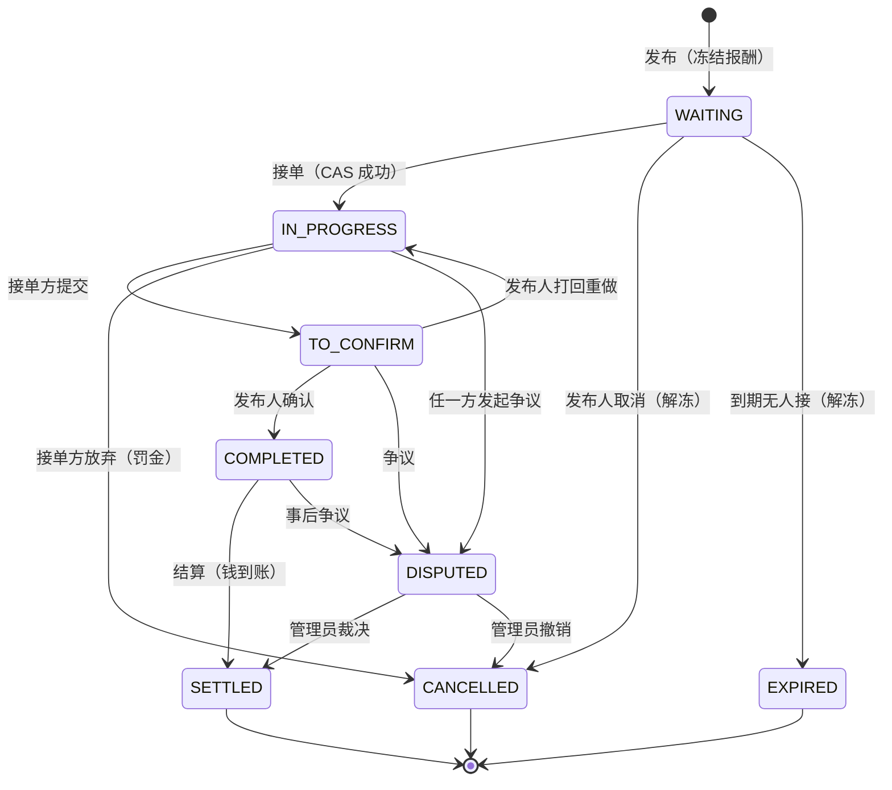
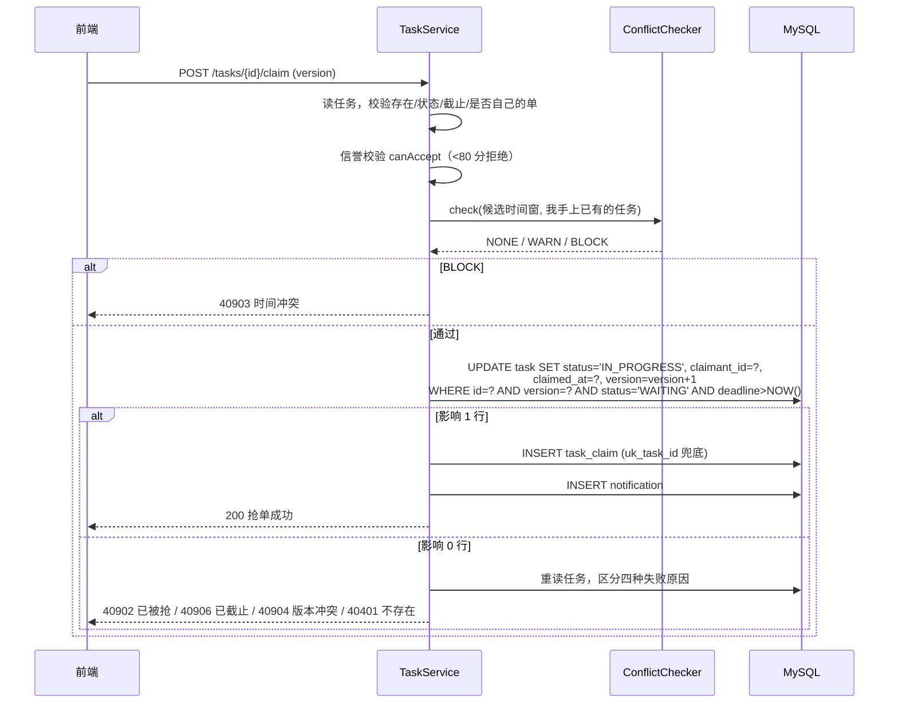

# 关键构件（模块）详细设计

- 项目：暴龙万事屋 —— 校园任务大厅平台
- 对应附表 4 第「四」栏
- 版本：V1.0 · 2026-11-09

---

## 一、整体分层

```
controller  ← HTTP 入口，只做参数校验与调用编排
   ↓
service     ← 业务规则、事务边界、跨模块协作
   ↓
algorithm   ← 纯函数算法（打分、评分、冲突、元数据），无 Spring 依赖，可单测
   ↓
mapper      ← 数据访问，关键路径用手写 SQL 保证原子性
   ↓
MySQL       ← 22 张表
```

`dto` 层里有一个特殊文件 `TaskWire`，它是**内核词汇与前端词汇的唯一翻译点**：

| 内核（数据库 / 枚举） | 前端（types.ts） | 中文 |
| --- | --- | --- |
| WAITING | OPEN | 待接取 |
| IN_PROGRESS | TAKEN | 进行中 |
| TO_CONFIRM | SUBMITTED | 待确认 |
| COMPLETED | COMPLETED | 已完成 |
| SETTLED | SETTLED | 已结算 |
| DISPUTED | DISPUTED | 争议中 |
| CANCELLED | CANCELLED | 已取消 |
| EXPIRED | EXPIRED | 已过期 |

接单状态同理：内核 `IN_PROGRESS / SUBMITTED / COMPLETED` ↔ 前端 `ACTIVE / ACTIVE / FINISHED`。

---

## 二、任务状态机

8 个状态、17 条合法迁移，迁移表写在 `enums/TaskStatus.TRANSITIONS` 里，是 `static final Map<TaskStatus, Set<TaskStatus>>`。



**为什么没有「进行中 → 待接单」**：接单方放弃时直接终止这次交易并扣罚金，任务重新发布由发布人决定。留一条回退边会让「谁在什么时候持有冻结金额」变得难以判定。

**冻结金额只在这些状态存在**：`holdsFrozenMoney()` 为 true 的 `WAITING / IN_PROGRESS / TO_CONFIRM / DISPUTED`。终态一律不持有，这是钱包对账的前提。

---

## 三、抢单并发控制

要求：200 个并发请求，只能有 1 个成功，其余必须收到明确原因。



**三层防线**

1. **Java 层**：状态机先判，明显非法直接拒绝，不打数据库。
2. **SQL 层**：`WHERE version=? AND status='WAITING' AND deadline>NOW()` 是原子条件，靠 InnoDB 行锁串行化，不依赖应用层加锁。
3. **约束层**：`task_claim.uk_task_id` 唯一索引兜底，即使前面全被绕过，第二条接单记录也插不进去。

---

## 四、钱包记账

**三条铁律**

1. 流水只增不改、不删。
2. `available − debt = SUM(该账户所有流水的 amount)`。
3. 每一次余额变动都必须有一个业务来源（`origin_type + origin_id`），可追溯。

**记账口径（迭代四的关键修正）**

`amount` 表示对**可用余额**的有符号影响：

| 场景 | available 变化 | frozen 变化 | 流水 amount |
| --- | --- | --- | --- |
| 注册赠送 / 管理员发币 | +100 | 0 | +100 GRANT |
| 发布任务冻结 | −200 | +200 | −200 FREEZE |
| 取消任务解冻 | +200 | −200 | +200 UNFREEZE |
| 任务结算（接单方） | +200 | 0 | +200 INCOME |
| 任务结算（发布方） | 不变 | −200 | 不记流水 |
| 违约扣罚 | −20（不足则挂 debt） | 0 | −20 PENALTY |
| 管理员冲正 | ±N | 0 | ±N REVERSAL |

> 发布方在结算时只做「冻结额度释放」（`consumeFrozen`），不写流水——因为它的钱在冻结那一步就已经记过 −200 了。这样每一行流水用户都读得懂，也不会出现金额为 0 的噪声流水。

**原子性**：所有余额变更都是带条件的原子 UPDATE，影响行数为 0 即代表余额不足，直接抛业务异常，绝不做「先查再改」。

```sql
-- 冻结（余额不足时影响 0 行）
UPDATE wallet_account
   SET available = available - #{amount},
       frozen    = frozen + #{amount}
 WHERE user_id = #{userId} AND available >= #{amount};
```

**幂等**：`wallet_transaction` 上有 `uk_origin(origin_type, origin_id, trans_type, account_id)` 与 `uk_idem(idem_key)`。同一业务事件重复触发时，先查 `idem_key` 是否已存在，存在就直接返回，不会重复扣钱。

---

## 五、信誉评分

**三段式平滑**

| 有效单量 n | 权重 α（真实数据占比） | 说明 |
| --- | --- | --- |
| n ≤ 5 | 0 | 完全用先验：完成率 0.90、准时率 0.90、争议率 0.05、取消率 0.05、评价 4.5 |
| 5 < n < 20 | (n−5)/15 | 真实数据与先验线性混合 |
| n ≥ 20 | 1 | 完全用真实数据 |

**总分公式**（满分 120，为了配合推荐算法的 `(credit−60)/60` 归一化）

```
score = 120 × ( 0.30×完成率 + 0.25×准时率 + 0.25×(评价/5) + 0.10×(1−争议率) + 0.10×(1−取消率) )
```

**等级映射**

| 分数 | 等级 | 能否接单 |
| --- | --- | --- |
| ≥ 110 | EXCELLENT | 能 |
| ≥ 95 | GOOD | 能 |
| ≥ 80 | NORMAL | 能 |
| ≥ 60 | LIMITED | 不能（只能发布任务） |
| < 60 | FROZEN | 不能 |

**统计窗口**：90 天滚动。发布人责任导致的取消不计入分母。触发时机：结算、评价、争议裁决之后异步重算，写一条流水留痕。

---

## 六、推荐算法

**候选池**：`status='WAITING' AND deadline > NOW() AND claimant_id IS NULL`，按发布时间倒序取 **200** 条（上限防止全表扫）。

**六因子权重**

| 因子 | 推荐权重 | 默认权重（无偏好） | 计算 |
| --- | --- | --- | --- |
| type | 0.40 | 0 | 类型偏好分 / 最高分，未见过的类型记 0.1 |
| reward | 0.20 | 0.30 | `exp(-(ln(r+1)-ln(μ+1))² / (2×0.8²))` |
| credit | 0.15 | 0.30 | `clamp((credit-60)/60, 0, 1)` |
| fresh | 0.15 | 0.30 | `0.5^(发布小时数/72)` |
| due | 0.05 | 0.05 | `clamp(1 - 剩余小时数/168, 0, 1)` |
| done | 0.05 | 0.05 | `min(1, ln(1+完成单量)/ln21)` |

**类型偏好采集**：每接取一次 +3，每收藏一次 +2，累加前乘 `0.5^(距今天数/30)`。

**冷启动**（历史行为 < 3 次）：

```
total = 0.3×min(1, reward/500) + 0.3×credit + 0.3×fresh + 0.05×due + 0.05×done
```

**多样性重排**：前 20 条结果里，同一发布者最多 2 条、同一类型最多 3 条；被挤下的条目按原顺序追加到尾部，保证不丢任务、只调顺序。

---

## 七、冲突检测

**两级判定**

| 级别 | 触发条件 | 系统行为 |
| --- | --- | --- |
| BLOCK | 时间窗重叠 **且** 任务类型要求独占（家教、辅导类） | 直接拒绝接单，返回 40903 |
| WARN | ① 时间窗重叠但类型不要求独占；② 时间不重叠、地点相同且相隔 ≤ 2 小时 | 允许接单，但返回提示文案 |
| NONE | 其他情况 | 放行 |

**设计约束**：本模块**只读、无副作用、不写库、不加锁**。它只负责「给出建议」，真正的并发安全由第三节的 SQL 条件更新保证。这样即使冲突检测有毫秒级的时序误差，也不会产生脏数据。

---

## 八、接口幂等

前端在写请求上带 `Idempotency-Key` 请求头。`IdempotentInterceptor` 的处理：

1. 只拦截 `POST / PUT / PATCH / DELETE`，且必须是已登录用户。
2. 取 `(user_id, key)` 尝试插入 `idem_record`。
3. 插入撞唯一索引 → 说明这个 key 已经处理过，直接返回 `{"code": 40907, "message": "重复提交，请勿多次点击"}`。
4. 插入成功 → 放行到业务逻辑。

**为什么用拦截器而不是在每个接口里写**：幂等是横切关注点，写在业务里容易漏；拦截器 + 数据库唯一索引，是「一次配置、全部生效」的做法。

---

## 九、定时兜底

`TaskScheduler` 每 10 分钟执行一次（启动后 30 秒先跑一次），两个任务：

| 任务 | 扫描条件 | 处理动作 |
| --- | --- | --- |
| `expireOverdue` | `status='WAITING' AND deadline < NOW()` | 解冻报酬 → 置 EXPIRED → 通知发布人 |
| `autoConfirm` | `task_claim.status='SUBMITTED' AND submitted_at < NOW()-72h` | 释放冻结 → 接单方入账 → 置 SETTLED → 双方重算信誉 → 通知 |

**为什么不用 Redis 延迟队列**：ZSet 方案需要额外中间件、重启后要恢复、失败重试逻辑要自己写。课程项目用固定频率轮询：可观测（日志一目了然）、零额外依赖、服务重启不丢任务，量级（几千条任务）完全够用。

---

## 十、数据库表一览（22 张）

| # | 表 | 说明 | 关键索引 |
| --- | --- | --- | --- |
| 1 | user | 用户 | uk_username、uk_phone |
| 2 | user_credit | 信誉档案（userId 为主键） | — |
| 3 | wallet_account | 钱包 | uk_user |
| 4 | wallet_transaction | 资金流水 | uk_idem、uk_origin、idx_user |
| 5 | task | 任务 | idx_status_deadline、idx_publisher、idx_claimant |
| 6 | task_claim | 接单记录 | uk_task_id |
| 7 | bargain_record | 议价 | idx_task_status |
| 8 | favorite | 收藏 | uk_user_target |
| 9 | browse_history | 浏览历史 | uk_user_target |
| 10 | conversation | 会话 | uk_pair |
| 11 | message | 消息 | idx_conversation |
| 12 | notification | 通知 | idx_user_read |
| 13 | post | 帖子 | idx_created |
| 14 | post_reply | 回帖 | idx_post |
| 15 | post_like | 点赞 | uk_post_user |
| 16 | report | 举报 | idx_status |
| 17 | dispute | 争议 | idx_status |
| 18 | audit_item | 审核项 | idx_status |
| 19 | system_config | 配置（`cfg_key` 主键） | — |
| 20 | login_log | 登录记录 | idx_user |
| 21 | admin_op_log | 管理操作日志 | idx_admin |
| 22 | idem_record | 幂等记录 | uk_idem_key |

> `system_config` 的主键叫 `cfg_key`、`idem_record` 的键叫 `idem_key`，是因为 `KEY` 是 MySQL 保留字，MyBatis-Plus 生成的 SQL 不会自动加反引号。

---

## 十一、错误码

| 码 | 常量 | 场景 |
| --- | --- | --- |
| 0 | SUCCESS | 成功 |
| 40000 | BAD_REQUEST | 参数或业务校验失败 |
| 40001 | SELF_ACCEPT | 不能接自己发布的任务 |
| 40100 | UNAUTHORIZED | 未登录 / token 失效（**返回真正的 HTTP 401**） |
| 40300 | FORBIDDEN | 无权限 |
| 40301 | CREDIT_LIMIT | 信誉不足，限制接单 |
| 40401 | TASK_NOT_FOUND | 任务不存在 |
| 40901 | TASK_STATUS_INVALID | 当前状态不允许该操作 |
| 40902 | TASK_ALREADY_TAKEN | 已被别人抢走 |
| 40903 | CONFLICT_SCHEDULE | 时间冲突 |
| 40904 | VERSION_CONFLICT | 版本冲突，请重试 |
| 40905 | BARGAIN_NOT_ALLOWED | 该任务不支持议价 |
| 40906 | DEADLINE_EXPIRED | 已过截止时间 |
| 40907 | IDEMPOTENCY_CONFLICT | 重复提交 |
| 50000 | SERVER_ERROR | 服务端异常 |

**与前端拦截器的约定**：`401` 必须是真实的 HTTP 状态码（前端据此清凭证并跳登录页），其余业务错误一律返回 HTTP 200 + 非 0 的 `code`。
