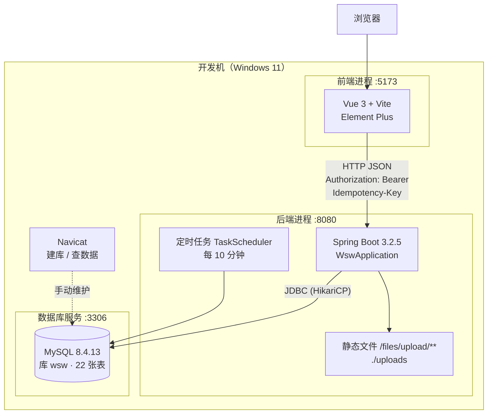
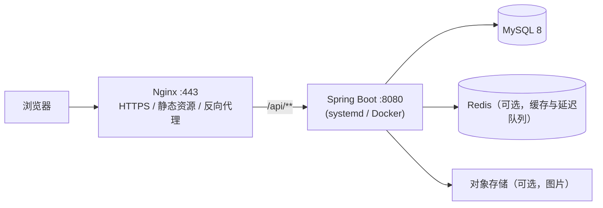

# 部署图与开发环境

- 项目：暴龙万事屋 —— 校园任务大厅平台
- 版本：V1.0 · 2026-11-09

---

## 一、部署图

### 1.1 本地开发 / 课堂演示部署（当前方式）



**说明**

- 前后端分离：前端 `vue-wsw`（Vite dev server，5173），后端 `wsw-server`（8080），通过 CORS 放行跨域（后端 `WebMvcConfig` 已允许全部来源并带 credentials）。
- 数据库与后端在同一台机器，`jdbc:mysql://localhost:3306/wsw`。
- 图片上传存本地磁盘 `./uploads/yyyyMM/`，通过 `/files/upload/**` 静态映射对外提供，不引入对象存储。
- 定时任务是后端进程内的 Spring `@Scheduled`，不单独部署。

### 1.2 若以后要放到公网（选做，未实施）



升级点只有三个：Nginx 统一入口与 HTTPS、MySQL 独立部署并开备份、图片从本地磁盘改对象存储。业务代码无需改动。

---

## 二、开发环境清单

| 类别 | 选型 | 版本 | 本机路径 / 备注 |
| --- | --- | --- | --- |
| 操作系统 | Windows | 11 | — |
| JDK | OpenJDK | **17.0.12** | `D:\jdk`；**必须显式设 `JAVA_HOME`**，PATH 里的 1.8 不能用 |
| 构建 | Maven | 3.9.16 | `D:\maven\apache-maven-3.9.16-bin\apache-maven-3.9.16\bin\mvn.cmd` |
| Maven 本地仓库 | — | — | `D:\zhn\.m2repo`（项目内，避免沙箱/权限问题） |
| 镜像 | 阿里云 | — | `~/.m2/settings.xml` → `https://maven.aliyun.com/repository/public` |
| 数据库 | MySQL | 8.4.13 | 服务名 `mysql84`，端口 3306 |
| 数据库客户端 | Navicat Premium | 16 | 导入 `sql/01-schema.sql` |
| 后端 | Spring Boot | 3.2.5 | web / validation |
| ORM | MyBatis-Plus | 3.5.7 | `mybatis-plus-spring-boot3-starter` |
| 鉴权 | jjwt | 0.12.5 | HS256 |
| 密码散列 | spring-security-crypto | 6.x | BCrypt |
| 测试 | JUnit 5 | — | `spring-boot-starter-test` |
| 前端 | Vue + TS + Vite + Element Plus | 见 `vue-wsw/package.json` | Node 18+ |
| IDE | IntelliJ IDEA | 2024.x | 学生可申请 Ultimate 免费授权 |
| 接口调试 | Apifox / Postman | — | 建议建一个「暴龙万事屋」项目 |
| 版本控制 | Git | — | `D:\Git\cmd\git.exe` |

---

## 三、启动步骤（从零到跑通）

### 3.1 建库建表

用 Navicat 连接到本机 MySQL，新建查询窗口，执行：

```
D:\zhn\wsw-server\sql\01-schema.sql
```

脚本会 `CREATE DATABASE IF NOT EXISTS wsw`（utf8mb4）并建 22 张表，**可重复执行**（每张表先 `DROP TABLE IF EXISTS`）。

命令行方式：

```bash
mysql -uroot -p < D:\zhn\wsw-server\sql\01-schema.sql
```

### 3.2 改数据库密码

打开 `src/main/resources/application.yml`，把 `spring.datasource.password` 改成你本机的 root 密码：

```yaml
spring:
  datasource:
    url: jdbc:mysql://localhost:3306/wsw?useUnicode=true&characterEncoding=utf8&serverTimezone=Asia/Shanghai&useSSL=false&allowPublicKeyRetrieval=true
    username: root
    password: 你的密码
```

### 3.3 启动后端

**方式一（IDEA，推荐）**：打开 `D:\zhn\wsw-server`，等 Maven 依赖下载完，运行 `WswApplication`。
IDEA 里需要确认 `Project Structure → SDK` 选的是 **JDK 17**。

**方式二（命令行）**：

```powershell
$env:JAVA_HOME = 'D:\jdk'
& 'D:\maven\apache-maven-3.9.16-bin\apache-maven-3.9.16\bin\mvn.cmd' `
    -f 'D:\zhn\wsw-server\pom.xml' `
    "-Dmaven.repo.local=D:\zhn\.m2repo" `
    spring-boot:run
```

启动成功后控制台会出现 `演示数据播种完成，默认密码：abc12345`。

### 3.4 启动前端

```bash
cd D:\zhn\vue-wsw
npm install
npm run dev
```

若 `npm install` 报「无法加载 npm.ps1，未对文件进行数字签名」，是 PowerShell 执行策略问题：

```powershell
Set-ExecutionPolicy -Scope CurrentUser RemoteSigned
```

（重开终端生效；或直接改用 `npm.cmd install`。）

### 3.5 验证

| 检查项 | 方法 | 期望 |
| --- | --- | --- |
| 后端存活 | 浏览器访问 `http://localhost:8080/tasks` | 返回 `{"code":0,"data":{...}}` |
| 登录 | 用 `linxiaoman / abc12345` 登录 | 返回 token，跳转任务大厅 |
| 钱包 | 个人中心 → 我的钱包 | 可用余额 1900（种子充值） |
| 推荐 | 任务大厅顶部「为你推荐」 | 有结果，且不含自己发布的 |
| 管理端 | 用 `admin / abc12345` 登录 → 管理后台 | 统计卡片有数字 |

---

## 四、常见问题

| 现象 | 原因 | 解决 |
| --- | --- | --- |
| `Access denied for user 'root'@'localhost'` | `application.yml` 密码不对 | 改成你本机 MySQL 密码 |
| `Unknown database 'wsw'` | 没导 SQL | 先执行 `sql/01-schema.sql` |
| 编译报 `invalid target release: 17` | Maven 用的是 JDK 1.8 | 设 `JAVA_HOME=D:\jdk`，或在 IDEA 里把 Maven Runner 的 JRE 改成 17 |
| Maven 依赖下载失败 / `AccessDeniedException: D:\mvnrep` | 本地仓库在受限目录 | 加 `-Dmaven.repo.local=D:\zhn\.m2repo` |
| 前端请求 401 后被踢回登录页 | 正常行为：token 过期 | 重新登录 |
| 定时任务没动静 | 日志级别只到 INFO 且无过期任务 | 正常；有任务时会打「定时任务完成」 |
| 上传图片 404 | `./uploads` 不存在 | 首次上传会自动创建；确认工作目录是项目根 |
| 中文乱码 | 数据库字符集不是 utf8mb4 | 脚本已指定 utf8mb4，检查客户端编码 |

---

## 五、演示账号

| 账号 | 密码 | 角色 | 说明 |
| --- | --- | --- | --- |
| admin | abc12345 | SADMIN | 最高权限，管理后台全部功能 |
| linxiaoman | abc12345 | USER | 已实名，发布过多条任务 |
| zhaolei | abc12345 | USER | 未实名 |
| chenyu | abc12345 | USER | 已实名 |

这些账号由 `DataSeeder` 在后端首次启动时创建（库里一个人都没有才执行），密码用 BCrypt 现场生成，因此**不要期待在 SQL 脚本里找到哈希值**。
