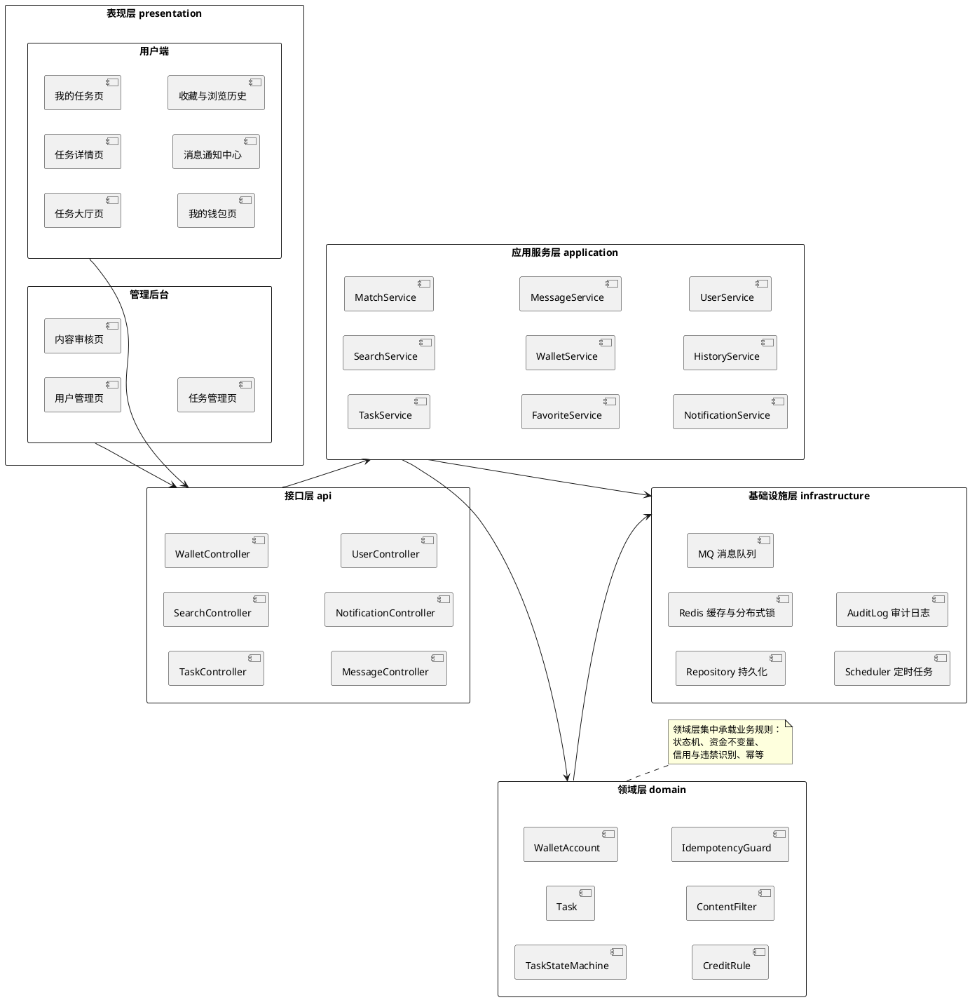
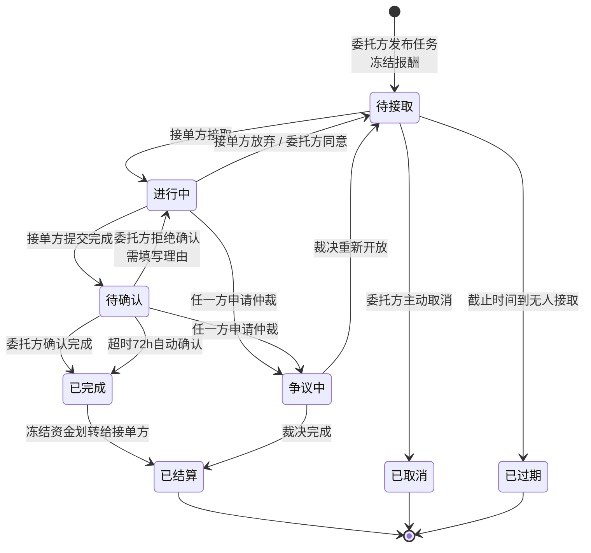
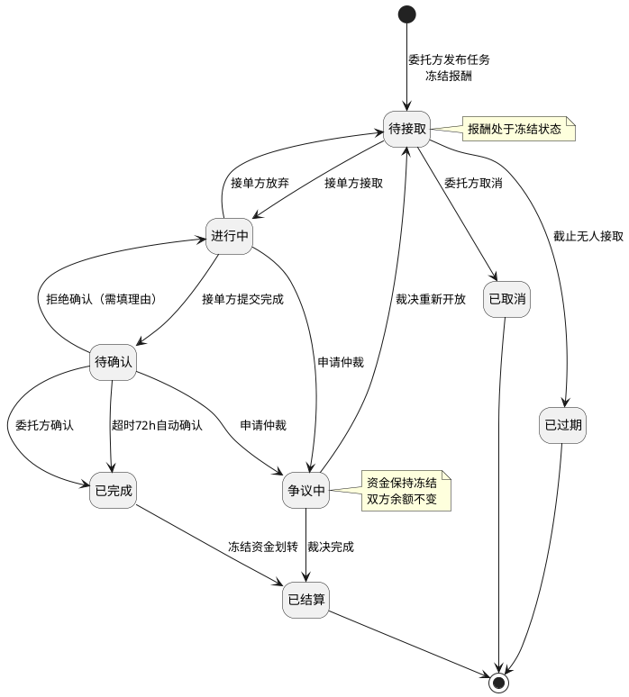
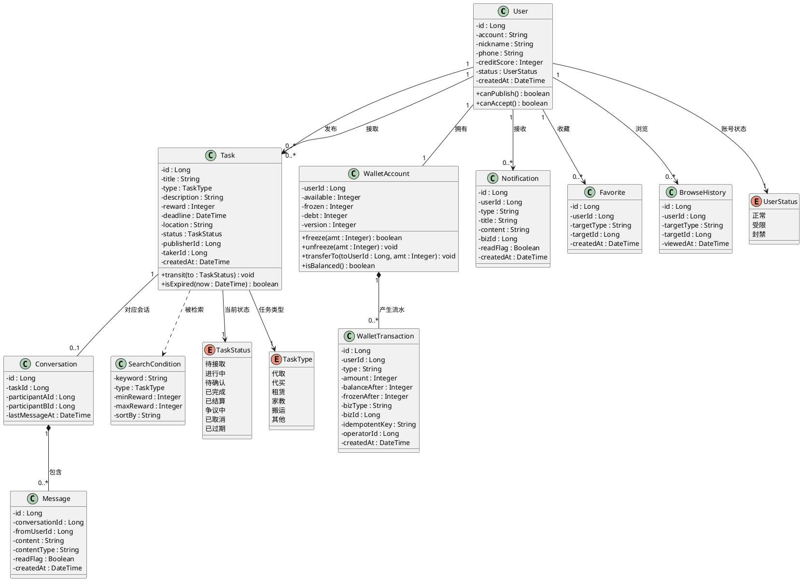

# 暴龙万事屋 · 迭代二 软件体系结构与建模图

> 依据：《需求文档 2》改进版需求模型
> 迭代二范围：TK-04~TK-08、TK-10~TK-12、MS-01/02、UC-02~UC-05、UA-05、PF-01~PF-03
> 迭代目标：**交易闭环** —— 搜索筛选 → 接取 → 状态流转 → 提交确认 → 结算 → 会话通知

| 建模类型 | 图 | 工具 |
|---|---|---|
| 软件体系结构图 | 包图 | PlantUML |
| 动态模型 | 任务状态图 | Mermaid / PlantUML |
| 静态模型 | 类图 | PlantUML |

**渲染方式**
- PlantUML：打开 <https://www.plantuml.com/plantuml/uml/>，粘贴代码，即可导出 PNG/SVG
- Mermaid：打开 <https://mermaid.live/>，粘贴代码，即可导出 PNG/SVG
- 也可导入 StarUML / ProcessOn / draw.io 手工重绘

---

## 一、软件体系结构图（包图）

### 1.1 分层依据

系统按**五层架构**组织，层与层之间只允许上层依赖下层，同层之间通过服务接口调用：

| 层 | 职责 | 迭代二涉及的内容 |
|---|---|---|
| 表现层 | 页面与交互 | 任务大厅、任务详情、我的任务、我的钱包、消息中心 |
| 接口层 | 参数校验、鉴权、路由 | TaskController、WalletController 等 |
| 应用服务层 | 用例编排、事务边界 | TaskService、WalletService、MessageService |
| 领域层 | 业务规则、状态机、不变量 | TaskStateMachine、CreditRule、ContentFilter、IdempotencyGuard |
| 基础设施层 | 持久化、缓存、消息、调度 | Repository、Redis、MQ、Scheduler |

**关键设计约束**

1. **资金操作只能经由 WalletService**，禁止任何其他层直接修改余额（对应需求 PF-01）
2. **状态变更只能经由 TaskStateMachine**，非法流转直接拒绝（对应 TK-10）
3. **资金变动与状态变更必须在同一事务**内完成（对应 NFR-02）
4. 调度器（超时自动确认、任务过期）通过延迟队列驱动，不直接扫描业务表（对应 TK-10）

### 1.2 PlantUML 源码



### 1.3 文字版层次结构（无法渲染时可照此重绘）

```
┌──────────────────────────────────────────────────────────┐
│ 表现层 presentation                                       │
│   用户端：任务大厅 · 任务详情 · 我的任务 · 我的钱包 · 消息通知中心 │
│   管理后台：用户管理 · 内容审核 · 任务管理                    │
├──────────────────────────────────────────────────────────┤
│ 接口层 api                                                │
│   TaskController · SearchController · WalletController    │
│   MessageController · NotificationController · UserController │
├──────────────────────────────────────────────────────────┤
│ 应用服务层 application                                     │
│   TaskService · SearchService · MatchService              │
│   FavoriteService · WalletService · MessageService        │
│   NotificationService · HistoryService · UserService      │
├──────────────────────────────────────────────────────────┤
│ 领域层 domain                                             │
│   TaskStateMachine · Task · WalletAccount                 │
│   CreditRule · ContentFilter · IdempotencyGuard           │
├──────────────────────────────────────────────────────────┤
│ 基础设施层 infrastructure                                  │
│   Repository · Redis · MQ · Scheduler · AuditLog          │
└──────────────────────────────────────────────────────────┘
```

### 1.4 包依赖说明

| 依赖 | 说明 |
|---|---|
| 表现层 → 接口层 | 页面通过 HTTP 调用接口，不直接访问服务层 |
| 接口层 → 应用服务层 | Controller 只做参数校验与鉴权，用例编排交给 Service |
| 应用服务层 → 领域层 | Service 调用状态机与领域规则，**业务规则不下沉到 Controller** |
| 应用服务层 → 基础设施层 | 通过 Repository 访问数据库，通过 MQ/Redis 处理异步与并发 |
| 领域层 → 基础设施层 | 领域对象只依赖抽象接口（仓储接口），不依赖具体实现 |

---

## 二、动态模型：任务状态图

### 2.1 建模范围

状态图描述**任务（Task）**对象在生命周期内的状态迁移，覆盖迭代二的 TK-08（接取）、TK-10（状态流转）、TK-11（提交确认）、TK-12（结算）以及仲裁分支。

### 2.2 Mermaid 源码



### 2.3 PlantUML 等价源码



### 2.4 状态迁移表

| 当前状态 | 事件 | 目标状态 | 触发方 | 资金处理 |
|---|---|---|---|---|
| 待接取 | 接取任务 | 进行中 | 接单方 | 保持冻结 |
| 待接取 | 取消任务 | 已取消 | 委托方 | 全额解冻 |
| 待接取 | 到达截止时间 | 已过期 | 系统 | 全额解冻 |
| 进行中 | 提交完成 | 待确认 | 接单方 | 保持冻结 |
| 进行中 | 放弃任务 | 待接取 | 接单方 | 保持冻结 |
| 进行中 | 申请仲裁 | 争议中 | 双方 | 冻结并标记争议 |
| 待确认 | 确认完成 | 已完成 | 委托方 | 保持冻结 |
| 待确认 | 超时 72 小时 | 已完成 | 系统 | 保持冻结 |
| 待确认 | 拒绝确认 | 进行中 | 委托方 | 保持冻结 |
| 已完成 | 资金划转 | 已结算 | 系统 | 冻结额 → 接单方余额 |
| 争议中 | 裁决完成 | 已结算 | 管理员 | 按裁决拆分或退回 |
| 争议中 | 裁决重新开放 | 待接取 | 管理员 | 保持冻结 |

### 2.5 状态不变量（答辩可讲）

1. **一个任务在整个生命周期内最多只有一条生效的接单记录**
2. **进入「已结算」时，冻结额与划转额必须相等**（拆分场景下两者之和相等）
3. **任何状态下都不允许余额为负**
4. **终态（已结算/已取消/已过期）不可再流转**

---

## 三、静态模型：类图

### 3.1 建模范围

覆盖迭代二的核心实体：用户、任务、钱包与流水、会话与消息、通知、收藏、浏览历史、检索条件。
（论坛的 Post / Comment 属于迭代一，本图省略。）

### 3.2 PlantUML 源码



### 3.3 类说明

| 类 | 职责 | 对应需求 |
|---|---|---|
| **User** | 平台用户，承载信用分与账号状态 | UA-04、TK-08 |
| **Task** | 委托任务，持有状态与报酬 | TK-02、TK-08、TK-10、TK-11 |
| **WalletAccount** | 屋币账户，含可用/冻结/欠款 | PF-01、TK-12、UC-05 |
| **WalletTransaction** | 不可变资金流水 | PF-01、PF-02 |
| **Conversation** | 任务双方的一对一会话 | MS-01 |
| **Message** | 会话中的一条消息 | MS-01 |
| **Notification** | 站内通知 | MS-02 |
| **Favorite** | 收藏任务或帖子 | TK-07、UC-03 |
| **BrowseHistory** | 浏览历史 | UC-04 |
| **SearchCondition** | 检索条件值对象 | TK-04、TK-05 |
| **TaskStatus** | 任务状态枚举（状态图的状态集合） | TK-10 |
| **TaskType** | 任务类型枚举 | TK-02 |

### 3.4 关系说明（答辩可讲）

| 关系 | 类型 | 说明 |
|---|---|---|
| User → Task（发布） | 一对多关联 | 一个用户可发布多个任务 |
| User → Task（接取） | 一对多关联 | 一个用户可接取多个任务；**Task 上 takerId 唯一非空时保证一单一接单人** |
| User ↔ WalletAccount | 一对一关联 | 每个用户有且仅有一个屋币账户 |
| WalletAccount ◆→ WalletTransaction | **组合** | 流水随账户存在，账户删除则流水无意义；流水**只增不改** |
| Task → Conversation | 一对零或一关联 | 任务被接取后产生会话 |
| Conversation ◆→ Message | **组合** | 消息离开会话无意义 |
| User → Notification / Favorite / BrowseHistory | 一对多关联 | 用户私有数据，接口必须做归属校验 |

### 3.5 关键设计约束

1. **WalletTransaction 不可修改**：类上不提供 setter，只能新增；纠错通过新增「冲正」记录实现（PF-01）
2. **WalletAccount 带 version 字段**：用乐观锁保证并发下不超扣（PF-02）
3. **Task.transit() 而非 setStatus()**：状态只能通过方法流转，内部调用状态机校验（TK-10）
4. **SearchCondition 是值对象**：无标识、不可变，用于组装查询条件（TK-04/05）

---

## 四、三张图的对应关系

```
需求模型（需求文档2）
        │
        ├── 包图 ──────── 系统由哪些包组成、如何分层依赖
        │
        ├── 状态图 ────── Task 对象在迭代二中的生命周期
        │                 对应类图中的 TaskStatus 枚举与 Task.transit()
        │
        └── 类图 ──────── 静态实体与关系
                          对应状态图中的「状态」是 TaskStatus 枚举
                          对应钱包实体支撑「已结算」状态的资金动作
```

**三图一致性检查**

- 状态图的 8 个状态 ↔ 类图中 `TaskStatus` 枚举的 8 个取值 ✅
- 状态图中「已结算」的资金动作 ↔ 类图中 `WalletAccount.transferTo()` ✅
- 状态图中「超时自动确认」 ↔ 包图中基础设施层的 `Scheduler` ✅
- 状态图中「争议中」↔ 包图管理后台的「内容审核页」与管理端仲裁 ✅
