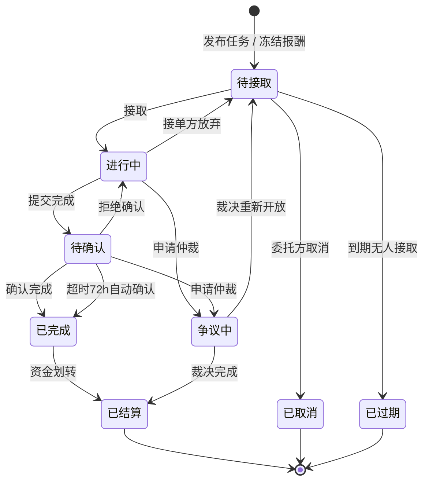
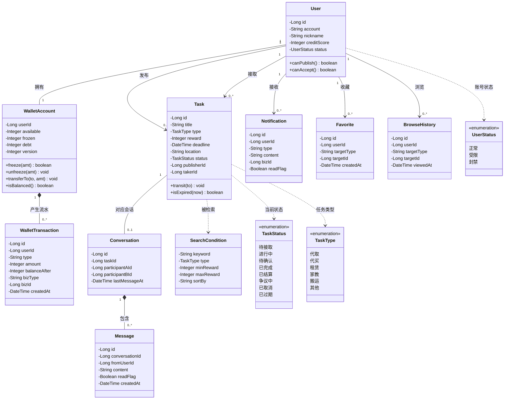
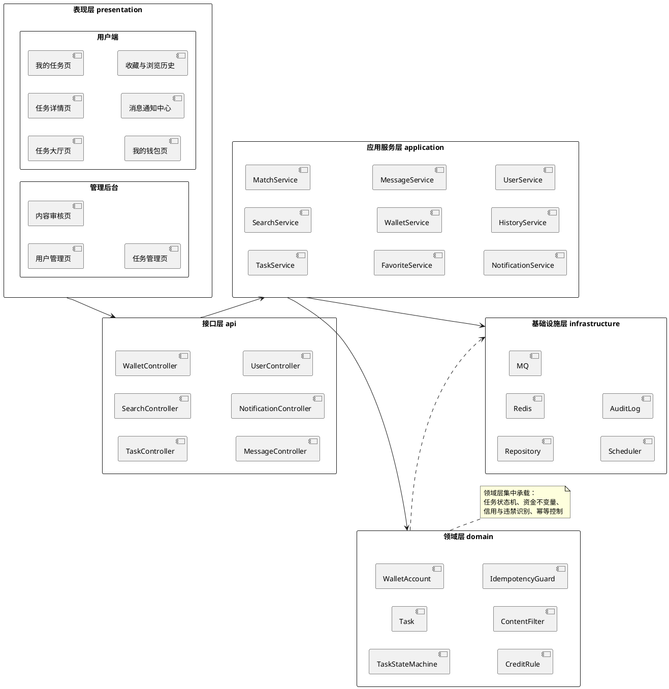
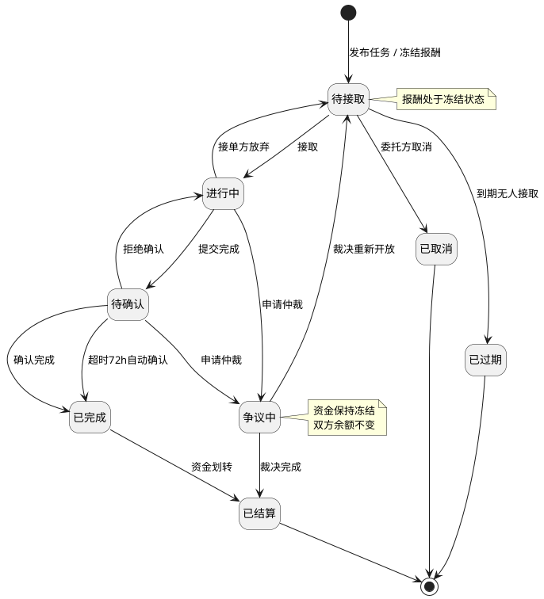
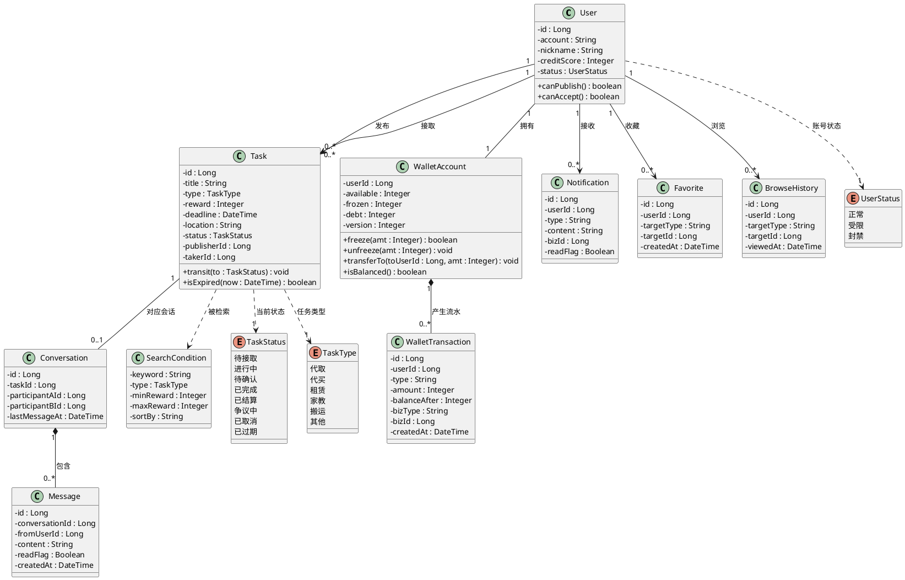

# 三张 UML 图 · 复制粘贴即用版

> 全程不需要安装任何软件，不需要命令行权限，不需要注册账号。

---

## 操作步骤（三张图都在同一个网站完成）

1. 浏览器打开 **<https://mermaid.live>**
2. 清空左边编辑框里的示例内容（全选 → 删除）
3. 把下面**第一张图**的代码整段粘贴进去
4. 右边立刻出图 → 点顶部 **Actions** → **Download PNG**
5. 换成第二张、第三张的代码，重复第 2–4 步

> ⚠️ **只复制代码块里面的内容**，不要复制 ` ```mermaid ` 和结尾的 ` ``` ` 这三行。

---

## 图 1：包图（软件体系结构）

```mermaid
flowchart TB
    subgraph L1["① 表现层 presentation"]
        direction LR
        subgraph U["用户端"]
            direction LR
            U1["任务大厅页"]
            U2["任务详情页"]
            U3["我的任务页"]
            U4["我的钱包页"]
            U5["消息通知中心"]
            U6["收藏与浏览历史"]
        end
        subgraph A["管理后台"]
            direction LR
            A1["用户管理页"]
            A2["内容审核页"]
            A3["任务管理页"]
        end
    end

    subgraph L2["② 接口层 api"]
        direction LR
        C1["TaskController"]
        C2["SearchController"]
        C3["WalletController"]
        C4["MessageController"]
        C5["NotificationController"]
        C6["UserController"]
    end

    subgraph L3["③ 应用服务层 application"]
        direction LR
        S1["TaskService"]
        S2["SearchService"]
        S3["MatchService"]
        S4["FavoriteService"]
        S5["WalletService"]
        S6["MessageService"]
        S7["NotificationService"]
        S8["HistoryService"]
        S9["UserService"]
    end

    subgraph L4["④ 领域层 domain"]
        direction LR
        D1["TaskStateMachine"]
        D2["Task 实体"]
        D3["WalletAccount"]
        D4["CreditRule"]
        D5["ContentFilter"]
        D6["IdempotencyGuard"]
    end

    subgraph L5["⑤ 基础设施层 infrastructure"]
        direction LR
        I1["Repository 持久化"]
        I2["Redis 缓存与锁"]
        I3["MQ 消息队列"]
        I4["Scheduler 定时任务"]
        I5["AuditLog 审计日志"]
    end

    L1 -->|依赖| L2
    L2 -->|依赖| L3
    L3 -->|依赖| L4
    L3 -->|依赖| L5
    L4 -.->|抽象依赖| L5
```



---

## 图 2：状态图（任务生命周期）



---

## 图 3：类图



---

## 导出设置建议

导出 PNG 之后，如果觉得图片太糊或太小：

- **mermaid.live**：顶部 `Actions` → `Download PNG`，部分版本支持设置缩放倍数
- 如果导出的是 SVG，可以直接拖进 Word，**矢量图放大不糊**，比 PNG 更适合报告

**建议**：报告里优先用 **SVG**；必须用 PNG 时尽量选高分辨率导出。

---

## 如果出问题

| 现象 | 原因 | 解决 |
|---|---|---|
| 中文显示成方块 | 中文字体缺失 | mermaid.live 一般没这问题；若遇到，换浏览器或改用 `plantuml.com` |
| 图太宽/太挤 | 自动布局 | 导出后在 Word 里调整大小；或删掉几个非核心的框 |
| 语法报错 | 复制时带上了 ` ``` ` 那三行 | 只复制代码块内部内容 |
| 状态图箭头交叉混乱 | 布局算法 | 想更规整就用下面的 PlantUML 版本 |

---

## 备选：PlantUML 版本（更标准的 UML 外观）

如果想让类图更"教科书"一点，打开 **<https://www.plantuml.com/plantuml/uml/>**，粘贴下面代码。

### 备选 1：包图



### 备选 2：状态图



### 备选 3：类图


