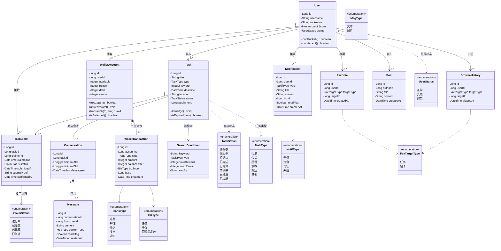
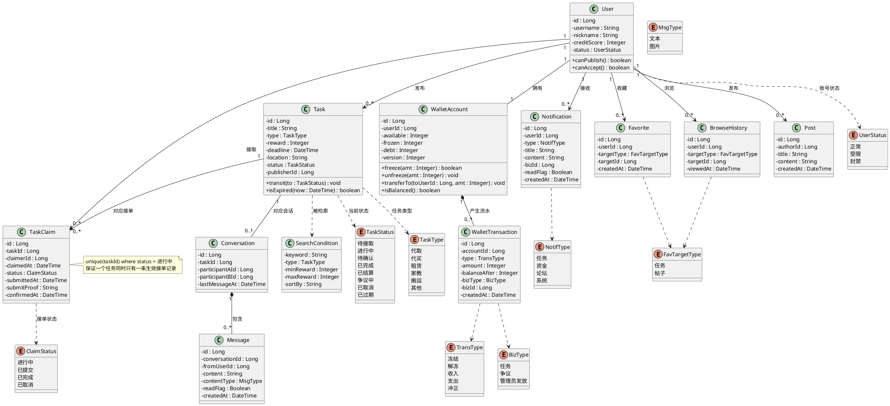

# 迭代二类图 · 修订版（v2）

> 渲染时用本文件的代码，替换 `05-三张图-复制粘贴即用.md` 里的「图 3」。
> 包图与状态图**不用改**。

---

## 一、改了什么，为什么改

| # | 豆包的建议 | 采纳 | 严重度 | 理由 |
|---|---|---|:---:|---|
| 1 | 缺 `TaskClaim` 接单记录类 | ✅ | 🔴 硬伤 | 确实漏了，且问题比它说的更严重 |
| 2 | `User.account` 改 `username` | ✅ | 🟡 改进 | 不是错误，但和 `WalletAccount` 撞名，容易误读 |
| 3 | 用 `String` 代替枚举 | ✅ | 🟠 该改 | 我前面定义了三个枚举，后面却用 String，双重标准 |
| 4 | `WalletTransaction` 改挂 `accountId` | ✅ | 🟡 改进 | 原设计不错，但教科书做法更规范，改的成本很低 |
| 5 | （豆包漏了）`Favorite` 引用不存在的 `Post` | ✅ | 🟠 该改 | `targetType` 有"帖子"，但类图里没有帖子类，属于悬空引用 |

### 关于第 1 条：为什么它是硬伤

豆包说得对，但理由还可以更硬。`Task` 里只有一个 `takerId`，扛不住四件事：

1. **唯一约束无处安放**。TK-08 要求「200 并发只成功一条接单记录」，这层保障只能靠 `unique(task_id)` 落在**一张接单表**上。`Task` 表上建不了这个约束。

2. **接单历史会丢失**。状态图里「接单方放弃 → 待接取 → 另一个人接取」，如果只有 `Task.takerId`，第二个人的 id 会**直接覆盖**第一个人的，历史没了。有 `TaskClaim` 才能保留每一次接单尝试。

3. **交付凭证存不下**。TK-11 要求提交「图片 + 文字说明」，这是结构化的凭证数据，塞进 `Task` 会让它变成什么都装的胖表。

4. **三个业务时刻混在一起**。`claimedAt`（接单）、`submittedAt`（提交完成）、`confirmedAt`（确认完成）是三个独立事件，分属三个阶段。

### 关于第 3 条：豆包的一个小错

它把 `WalletTransaction.type` 和 `bizType` 归到同一个 `TransType` 枚举里，这不对——**这是两个不同维度**：

- `type`：这笔钱是**怎么动的**（冻结 / 解冻 / 收入 / 支出 / 冲正）
- `bizType`：这笔钱是**因为什么动的**（任务 / 争议 / 管理员发放）

所以修订版拆成 `TransType` 和 `BizType` 两个枚举。

### 关于第 5 条：豆包漏掉的

原来的类图里：

```
Favorite.targetType 取值 = 任务 / 帖子
```

但整张图**没有 Post 类**。这是典型的悬空引用——和需求文档里「消息对话依赖不存在的任务详情页」是同一类问题。

修订版补了一个最小化的 `Post`，并注明论坛的完整模型（Post / Comment）属于迭代一。

---

## 二、修订后的类图（Mermaid 版）



---

## 三、修订后的类图（PlantUML 版）

> 想要更"教科书"的外观就用这个，粘到 `plantuml.com/plantuml/uml`。



---

## 四、如果图太宽怎么办

修订版比原来多了 `TaskClaim`、`Post` 和 6 个枚举，横向会更长。三个处理办法：

| 办法 | 做法 |
|---|---|
| **A. 精简枚举** | 只保留 `TaskStatus`、`TaskType`、`ClaimStatus`、`UserStatus` 四个枚举框，其余（`TransType`、`BizType`、`NotifType`、`FavTargetType`、`MsgType`）删掉——属性里仍写枚举类型名，语义不变 |
| **B. 删次要类** | 删掉 `Favorite`、`BrowseHistory`、`SearchCondition`，保留主干（User / Task / TaskClaim / WalletAccount / WalletTransaction / Conversation / Message / Notification） |
| **C. 拆两张图** | 一张「任务与资金核心模型」，一张「消息与收藏辅助模型」，报告里放两张，更清楚 |

**建议**：交作业用 **A**，既不丢信息，版面也收得住。

---

## 五、修订后的图说明（可直接抄进报告）

> **图 3 说明**：本图给出迭代二的核心领域模型，共 12 个实体类与 9 个枚举。
>
> 任务与接单分离建模：`Task` 表示委托本身，`TaskClaim` 表示一次接单记录，二者为一对多关系。这样既能在 `TaskClaim` 上建唯一约束以保证「一个任务同时只有一条生效接单记录」，也能保留接单方放弃的历史记录，避免 `Task` 上的接单人字段被覆盖。
>
> 资金模型上，`WalletAccount` 与 `WalletTransaction` 为组合关系，且流水对象不提供修改方法，保证账目只增不改；`WalletTransaction` 通过 `accountId` 关联账户而非直接关联用户，便于后续扩展多账户场景。
>
> 状态与类型一律使用枚举而非字符串，避免在业务逻辑中出现魔法值。`Task` 通过 `transit()` 方法流转状态，内部调用状态机校验，避免状态被直接篡改。

---

## 六、需要同步的地方

| 文件 | 是否需要改 |
|---|---|
| `05-三张图-复制粘贴即用.md` 的图 3 | ⚠️ 用本文件替换 |
| `05-三张图-复制粘贴即用.md` 的图 1、图 2 | ✅ 不用改 |
| `04-迭代二-UML手绘指南与文本版图.md` 的类图章节 | ⚠️ 手绘时以本文件为准 |
| `03-迭代二-软件体系结构与建模图.md` 的类图 | ⚠️ 已被本文件取代 |
| 状态图、包图 | ✅ 不用改 |

**状态图不需要改**的理由：`TaskClaim` 属于接单记录，不改变任务本身的状态集合；状态图的 8 个状态与 `TaskStatus` 枚举仍然一一对应。
