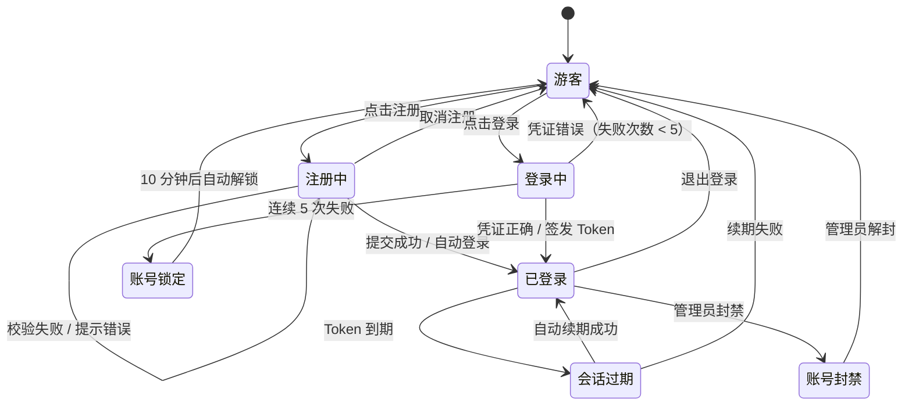
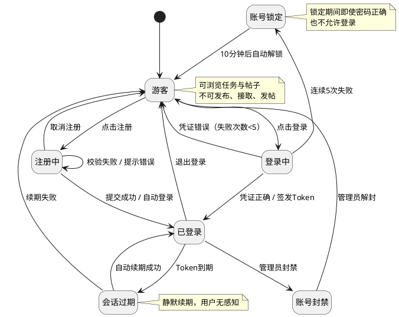
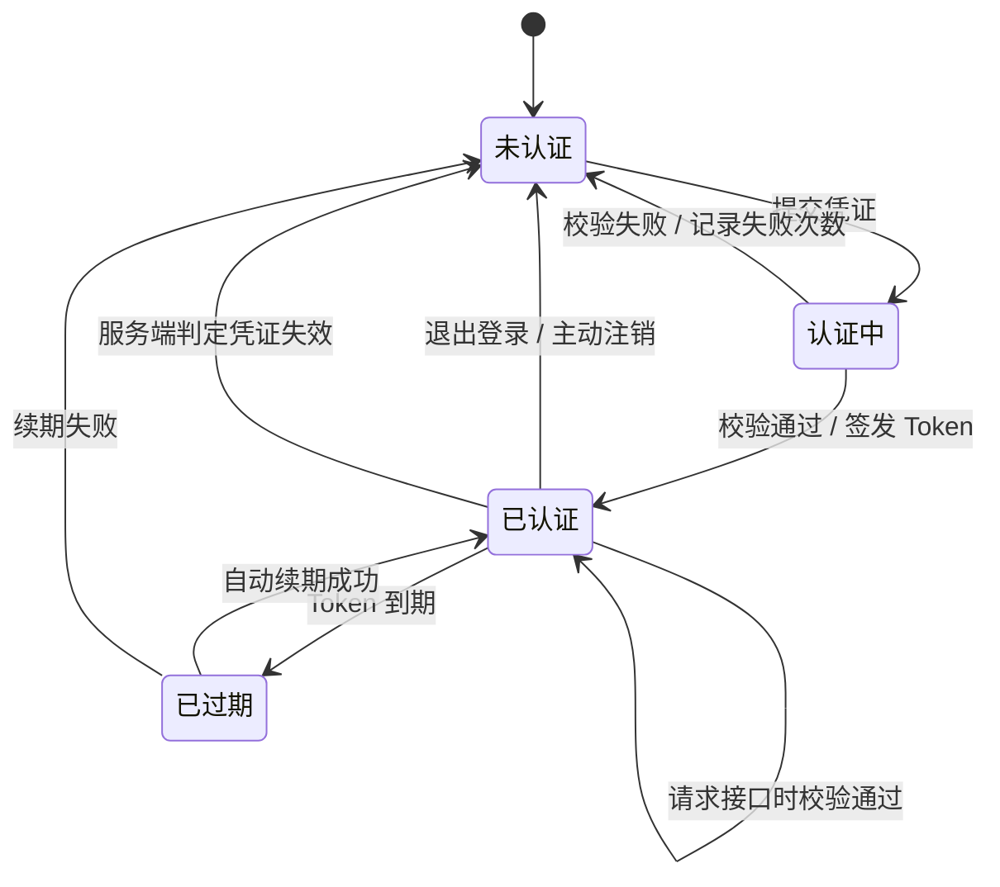
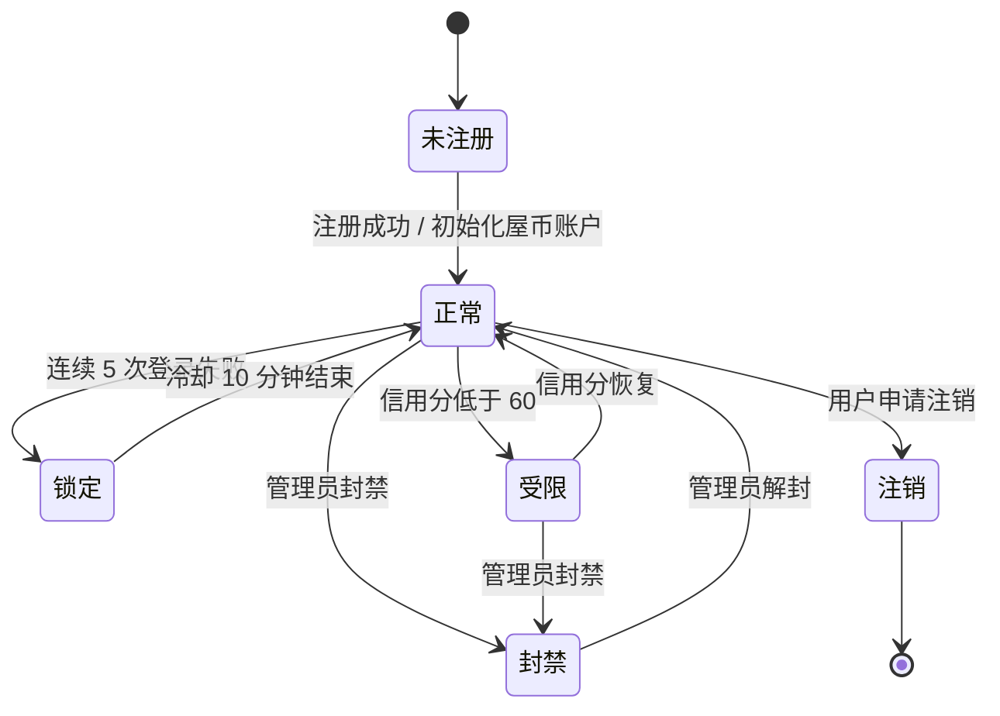

# 迭代二 · 登录注册模块 状态图

> 模块负责人：你
> 对应需求：UA-01 注册、UA-02 登录、UA-03 退出登录、UA-04 访问控制、UA-05 游客访问与登录引导
> 对应原 TAPD：1000059 注册或登录功能、1000063 注册、1000064 登录

---

## 一、先确定"画谁的状态"

UML 状态图描述的是**一个对象在其生命周期内的状态变化**。登录注册模块有两个值得建模的对象：

| 对象 | 状态维度 | 覆盖哪些需求 |
|---|---|---|
| **登录会话 Session** | 未登录 / 认证中 / 已登录 / 已过期 | 登录、退出、Token 续期 |
| **用户账号 User** | 正常 / 锁定 / 封禁 | 注册、失败锁定、管理员封禁 |

**两种画法**：

- **画法 A（推荐交作业）**：合并成一张「模块状态图」，以"用户身份"为主线，覆盖注册、登录、登出、锁定、封禁
- **画法 B（更严格）**：拆成两张对象级状态图，一张会话、一张账号

绝大多数课程作业用画法 A 就够了。如果老师强调"状态图的 lifeline 只能是一个对象"，就用画法 B。

下面先给 A，再给 B。

---

## 二、主图（画法 A）：登录注册模块状态图

### 2.1 Mermaid 版（粘到 <https://mermaid.live>）

### 2.2 PlantUML 版（粘到 <https://www.plantuml.com/plantuml/uml/>）

### 2.3 状态说明

| 状态 | 含义 | 可执行操作 | 对应需求 |
|---|---|---|---|
| **游客** | 未登录，只能浏览公开内容 | 浏览任务大厅、任务详情、帖子 | UA-05 |
| **注册中** | 正在填写并提交注册表单 | 填写、提交、取消 | UA-01 |
| **登录中** | 已提交凭证，正在校验 | 等待结果 | UA-02 |
| **已登录** | 持有有效 Token | 全部功能 | UA-02、UA-04 |
| **会话过期** | Token 到期，可静默续期 | 续期、重新登录 | UA-02 |
| **账号锁定** | 连续 5 次密码错误，冷却 10 分钟 | 等待解锁 | UA-02 |
| **账号封禁** | 被管理员封禁 | 等待解封 | UA-04 |

### 2.4 转移说明

| # | 从 | 到 | 事件 | 守卫条件 / 动作 |
|---|---|---|---|---|
| 1 | ● | 游客 | 进入系统 | 无 |
| 2 | 游客 | 注册中 | 点击注册 | — |
| 3 | 注册中 | 游客 | 取消注册 | — |
| 4 | 注册中 | 注册中 | 校验失败 | 账号为空 / 密码不合规 / 两次不一致 / 手机号非法 / 账号已存在 |
| 5 | 注册中 | 已登录 | 提交成功 | 账号创建 + 屋币账户初始化 + 赠送 100 WB（同一事务） |
| 6 | 游客 | 登录中 | 点击登录 | — |
| 7 | 登录中 | 已登录 | 凭证正确 | 签发 Token，有效期 7 天 |
| 8 | 登录中 | 游客 | 凭证错误 | 失败次数 < 5，提示"账号或密码错误" |
| 9 | 登录中 | 账号锁定 | 连续 5 次失败 | 记录锁定起始时间 |
| 10 | 账号锁定 | 游客 | 锁定满 10 分钟 | 失败次数清零 |
| 11 | 已登录 | 会话过期 | Token 到期 | — |
| 12 | 会话过期 | 已登录 | 自动续期成功 | 静默刷新，用户无感知 |
| 13 | 会话过期 | 游客 | 续期失败 | 清除本地凭证 |
| 14 | 已登录 | 游客 | 退出登录 | 清除本地凭证 + 服务端凭证失效 |
| 15 | 已登录 | 账号封禁 | 管理员封禁 | 强制下线并通知 |
| 16 | 账号封禁 | 游客 | 管理员解封 | 允许重新登录 |

### 2.5 写进报告的图说明（可直接抄）

> **图 X 说明**：本图描述登录注册模块中用户身份状态的迁移。初始状态为「游客」，可浏览公开内容但不可发布或接取任务（UA-05）。点击注册进入「注册中」，表单校验失败时在原状态自循环并给出字段级错误提示，校验通过后创建账号并初始化屋币账户，同时自动登录进入「已登录」。
>
> 登录路径从「游客」经「登录中」校验凭证后进入「已登录」；连续 5 次密码错误触发「账号锁定」，冷却 10 分钟后自动解锁。已登录状态下 Token 到期进入「会话过期」，可静默续期返回「已登录」，续期失败则退回「游客」。管理员封禁会使已登录用户进入「账号封禁」，解封后回到「游客」。

---

## 三、备选（画法 B）：拆成两张对象级状态图

如果老师要求「一张状态图只描述一个对象」，就用下面两张，报告里放两张、各配一句说明。

### 3.1 图 B1：登录会话（Session）状态图

### 3.2 图 B2：用户账号（User）状态图

> 这两个方案可以二选一，也可以两张都画（老师通常会给"分模块 + 分对象"双份加分）。

---

## 四、容易踩的坑

| 坑 | 说明 |
|---|---|
| **忘了起点和终点** | UML 状态图必须有实心圆起点；本模块没有天然终态，可以只画起点 |
| **状态名混用动词和形容词** | 「已登录」「注册中」是状态，「登录」「注册」是事件，别混 |
| **把操作画成状态** | "点击登录"是事件不是状态 —— 事件写在箭头上，状态写在框里 |
| **守卫条件没写** | 「凭证错误 → 游客」和「连续 5 次失败 → 账号锁定」要能区分，靠守卫条件 `失败次数 < 5` |
| **自循环没画** | 「注册中 → 注册中（校验失败）」是自循环，很多同学会漏掉，这是**最能体现你思考过的地方** |
| **状态不可达** | 画完检查一遍：每个状态是不是都有入边 |

---

## 五、和其他图的一致性

| 检查项 | 结果 |
|---|---|
| 「账号锁定」↔ 需求 UA-02「连续 5 次失败锁定 10 分钟」 | ✅ 一致 |
| 「注册中 → 已登录」↔ 需求 UA-01「注册成功后直接登录」 | ✅ 一致 |
| 「已登录 → 会话过期 → 已登录」↔ 需求 UA-02「Token 7 天，支持自动续期」 | ✅ 一致 |
| 「游客」可浏览 ↔ 需求 UA-05 | ✅ 一致 |
| 「账号封禁」↔ 管理后台 AD-01 封禁/解封 | ✅ 一致 |
| 与迭代二主状态图（任务状态机）的关系 | 本图是**用户身份**的状态，任务状态机是**任务**的状态，两张图描述不同对象，不冲突 |

---

## 六、提交建议

1. 报告里本图单独占一页，图下配 2.5 节那段说明文字
2. 图编号跟在团队的状态图主编号后面（比如你们组任务状态图是图 2，本图就是图 3）
3. 如果老师要求每人交一张，就在图标题里写清楚：「图 3　登录注册模块状态图（XXX 负责）」
4. 导出用 **SVG**，插入 Word 不糊
