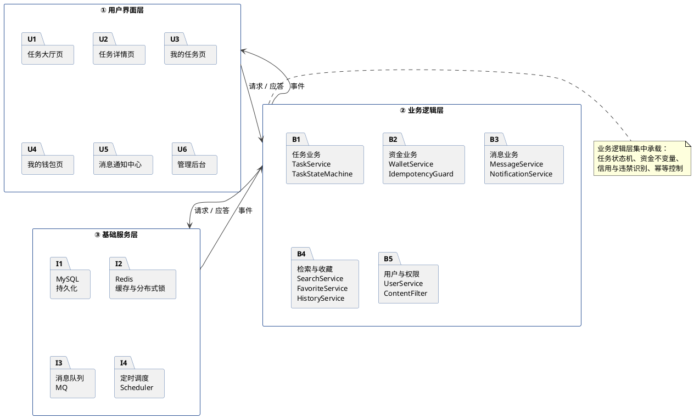
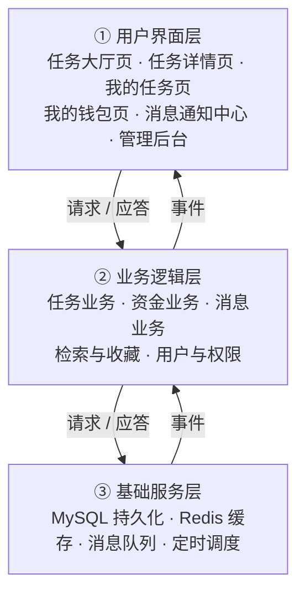

# 软件体系结构包图 · 复刻老师示例风格

> 目标：把竖排的流程图改成和老师示例一致的**三层横向色带 + 包符号横排**样式

---

## 一、为什么你现在的图是竖排的

Mermaid 的子图有个已知限制：

> **子图内写了 `direction LR`，但只要这个子图还连了子图外的元素，`direction` 就会被忽略。**

你的代码里写了 `direction LR`，同时又用 `L1 --> L2` 把各层连了起来——所以横向排版失效，所有节点被压成了竖列。

**结论：Mermaid 画不出老师那种效果**，换成 PlantUML（或者 draw.io，见第三节）。

---

## 二、结构上的调整：5 层 → 3 层

老师示例是三层：**用户界面层 / 业务逻辑层 / 基础服务层**。这正好是标准的「三层架构」画法。

我原来的五层（表现 / 接口 / 应用服务 / 领域 / 基础设施）拆得细，但和老师的示例风格不一致。改成三层后，把接口层和领域层**收进业务逻辑层内部**，信息不丢：

| 原五层 | 归入 |
|---|---|
| 表现层 | ① 用户界面层 |
| 接口层 + 应用服务层 + 领域层 | ② 业务逻辑层 |
| 基础设施层 | ③ 基础服务层 |

---

## 三、PlantUML 代码（粘到 <https://www.plantuml.com/plantuml/uml/>）

### 关键点说明

| 写法 | 作用 |
|---|---|
| `skinparam packageStyle folder` | 让包变成**文件夹形状**，和老师示例一致 |
| `rectangle "① 用户界面层"` | 每层画成一个大矩形，即"横向色带" |
| `together { ... }` | **强制包横排**，避免被自动拆成竖列 |
| `L2 -up-> L1 : 事件` | 画**向上的箭头**，对应老师的"事件"回传线 |
| `top to bottom direction` | 层与层竖着叠 |

---

## 四、如果 PlantUML 出来的还不是横排

PlantUML 用的是自动布局，`together` 在少数版本里不生效。**要 100% 复刻老师那张图，用 draw.io，5 分钟能画完：**

### draw.io 复刻步骤

1. 打开 **<https://app.diagrams.net>**，新建空白图
2. 左侧面板底部点 **`More Shapes`** → 勾选 **`UML`** → `Apply`
3. 左侧找到 **Package** 形状（一个带小标签页的矩形），拖到画布
4. 画三个**大矩形**作为三层容器，左上角写层名：
   - `① 用户界面层`
   - `② 业务逻辑层`
   - `③ 基础服务层`
5. 每个容器里拖入 4–6 个 **Package** 形状，**横向排开**（直接拖动摆位置，不受自动布局限制）
6. 用**实线箭头**从上层指向下层，双击连线写标签 `请求 / 应答`
7. 再用一条**反向箭头**从下层指回上层，标签写 `事件`
8. 顶层内部可以加一条横向虚线箭头，模拟老师图里 `调用用户命令 → Linphone4Android ← 显示老人状况` 那种关系
9. 导出：`File` → `Export as` → **SVG**（报告用）或 PNG

### 三个细节，做到就像了

| 细节 | 做法 |
|---|---|
| **层容器用浅色填充** | 选中大矩形，右侧 `Style` 标签页设填充色为浅灰 `#F5F5F5` |
| **包符号用文件夹形** | 就用 UML 的 `Package` 形状，别用圆角矩形 |
| **箭头写标签** | `请求/应答` 向下、`事件` 向上，这是老师图里最显眼的特征 |

---

## 五、如果一定要用 Mermaid

只能退而求其次，做**层级清晰的竖排**，视觉上和老师的不一样，但结构是对的：

这个的好处是**排版稳定、不会挤**，缺点是包符号变成了文字框。**不推荐交作业用**，除非时间实在来不及。

---

## 六、导出前记得改主题

你截图里是**深色背景**，放进 Word 报告会很难看。mermaid.live 和 plantuml.com 都能改：

- **mermaid.live**：左边 `Config` 标签 → 把 theme 改成 `default` 或 `neutral`；也可以在代码最前面加一行 `%%{init: {'theme':'default'}}%%`
- **plantuml.com**：代码里加 `skinparam backgroundColor #FFFFFF`（上面给的代码已经包含）

---

## 七、给你的建议

| 情况 | 选哪个 |
|---|---|
| 想让图和老师示例神似 | **draw.io**（第四节），可控性最高 |
| 想快、能接受自动布局 | **PlantUML**（第三节），先试 `together` 能不能横排 |
| 已经画完了懒得改 | 保留 Mermaid 竖排版，但报告里配说明文字解释「自上而下分层」 |

我建议：**先用 PlantUML 试一次**，如果包是竖着叠的，直接转 draw.io——别在自动布局上耗时间，draw.io 手摆反而更快。
