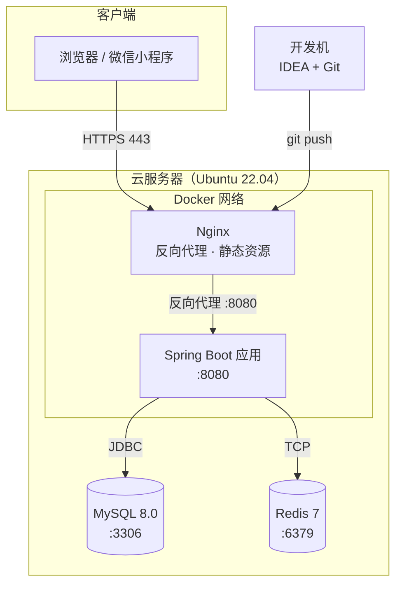

# 实习三 · 迭代三 任务书

> 项目：暴龙万事屋 —— 校园委托互助平台
> 依据：《需求文档 2》迭代规划与附表 3 要求
> 说明：负责人一列用 TAPD 成员名占位，**你负责的登录注册模块标为【本人】**，请按实际分工替换名字。

---

## 一、迭代二回顾会议纪要（要求 1）

### 1.1 会议信息

| 项 | 内容 |
|---|---|
| 会议名称 | 迭代二回顾会（Sprint 2 Retrospective） |
| 时间 | 迭代二结束后第 1 天，约 90 分钟 |
| 参与人 | 全体开发成员（张皓宁、Dybk、上上qian、陈长洲、李浩铭） |
| 议程 | ① 集成后演示迭代二增量（40 min）→ ② 逐项核对验收标准（20 min）→ ③ 讨论改进点（20 min）→ ④ 输出行动项（10 min） |
| 产出 | 本纪要 + 迭代三任务清单 |

### 1.2 集成演示的增量

迭代二的目标是**交易闭环**，本次演示走通的主链路：

```
游客浏览 → 登录 → 搜索/筛选任务 → 接取任务 → 双方会话
    → 接单方提交完成 → 委托方确认 → 屋币划转 → 双方收到通知
```

演示中额外验证了两条异常链路：

1. 接单方放弃 → 任务重新回到大厅，另一个人成功接取
2. 委托方超时未确认 → 72 小时自动确认（用改短超时时间的方式验证）

### 1.3 各任务完成程度

| 编号 | 任务 | 完成程度 | 说明 |
|---|---|:---:|---|
| TK-08 | 接取任务 | 100% | 含 200 并发压测，仅 1 条成功 |
| TK-10 | 任务状态流转 | 95% | 主路径完成，争议分支未联调 |
| TK-11 | 提交完成与确认 | 90% | 超时自动确认已用短周期验证 |
| TK-12 | 任务报酬与结算 | 85% | 全额划转完成，拆分场景未覆盖 |
| PF-01 | 虚拟货币账户体系 | 100% | 恒等式校验通过 |
| PF-02 | 资金安全与幂等 | 80% | 划转接口已接入，发放接口未接 |
| PF-03 | 违禁内容识别 | 60% | 精确匹配可用，变体绕过未处理 |
| TK-04 | 搜索 | 100% | 中文检索与高亮正常 |
| TK-05 | 筛选与排序 | 90% | 类型/报酬/时间可用，地点筛选未做 |
| TK-06 | 偏好推荐 | 0% | 评估后移入迭代三 |
| TK-07 | 收藏任务 | 100% | — |
| MS-01 | 任务会话 | 85% | 收发正常，断线重连未处理 |
| MS-02 | 通知中心 | 70% | 站内通知完成，微信推送未接 |
| UC-02 | 我的任务 | 100% | 状态分组与操作按钮正确 |
| UC-03 | 我的收藏 | 100% | — |
| UC-04 | 浏览历史 | 100% | — |
| UC-05 | 我的钱包 | 95% | 余额与流水正常，冻结明细待展开 |
| UA-05 | 游客访问与登录引导 | 100% | — |

**完成率**：17 项中 11 项 100%，6 项 60%–95%，1 项延后。按故事点加权约 **82%**。

### 1.4 改进点（会议讨论结论）

| 类别 | 问题 | 行动项 | 责任人 |
|---|---|---|---|
| **代码结构** | Controller 里还有业务判断，Service 变成"透传" | 迭代三起 Controller 只做参数校验与鉴权，业务全部下沉 Service | Dybk |
| **错误处理** | 各接口错误码不统一，前端要靠文案判断 | 迭代三第一周前统一错误码表，`@RestControllerAdvice` 集中处理 | 张皓宁 |
| **测试** | 回归靠手点，改一处坏一处没发现 | 加 JUnit 单测，覆盖资金与状态流转；关键接口加集成测试 | 全体 |
| **性能** | 任务列表存在 N+1 查询，列表慢 | 改为关联查询 + 索引优化，补 `EXPLAIN` 记录 | Dybk |
| **文档** | 接口改了但接口文档没同步 | 用 springdoc 自动生成，提交前必须能访问 `/swagger-ui` | 李浩铭 |
| **协作** | 分支直接从 main 切，合并冲突多 | 改用 Git Flow：`feature/*` → `develop` → `main` | 陈长洲 |
| **评审** | 没有代码评审，质量取决于个人 | 每个 PR 至少 1 人 review 才可合入 | 全体 |

---

## 二、迭代三任务与分工（要求 2，明确到人）

**迭代目标**：从"能交易"走向"能运营" —— 补管理后台、评价信用、议价，并完成登录注册模块的安全增强。

### 2.1 任务清单

| 编号 | 任务 | 负责人 | 故事点 | 优先级 |
|---|---|---|---:|---|
| **【登录注册模块】** | | | | |
| UA-06 | 密码找回与重置 | **【本人】** | 5 | P0 |
| UA-07 | 学号实名认证 | **【本人】** | 5 | P1 |
| UA-08 | 登录安全与登录日志 | **【本人】** | 3 | P0 |
| **【任务与交易】** | | | | |
| TK-06 | 偏好推荐 | Dybk | 5 | P2 |
| TK-09 | 议价 | Dybk | 5 | P2 |
| TK-13 | 评价与信用 | 上上qian | 5 | P1 |
| **【消息与社区】** | | | | |
| MS-02b | 通知中心完善（微信/邮件推送） | 上上qian | 3 | P1 |
| AD-03a | 用户端举报入口 | 陈长洲 | 3 | P1 |
| FM-06 | 帖子举报与举报理由选择 | 陈长洲 | 2 | P1 |
| **【个人中心】** | | | | |
| UC-06 | 账号设置页（改密/解绑/注销） | 李浩铭 | 3 | P1 |
| UC-07 | 冻结明细展开 | 李浩铭 | 2 | P2 |
| **【管理后台】** | | | | |
| AD-01 | 用户管理 | 张皓宁 | 5 | P0 |
| AD-02 | 内容审核 | 张皓宁 | 5 | P0 |
| AD-03 | 举报与仲裁 | 张皓宁 | 8 | P1 |
| AD-04 | 任务管理 | 张皓宁 | 5 | P2 |
| AD-05 | 数据统计 | 张皓宁 | 5 | P1 |
| AD-06 | 虚拟货币管理 | 张皓宁 | 8 | P1 |
| **【平台能力】** | | | | |
| PF-04 | 操作日志 | Dybk | 3 | P2 |
| PF-05 | 错误码统一与全局异常处理 | 全体 | 3 | P0 |

**合计故事点：85**，按 2 周迭代、团队 5 人估算可承载。

### 2.2 本人（登录注册模块）迭代三任务说明

| 编号 | 任务 | 要做的事 |
|---|---|---|
| **UA-06** | 密码找回与重置 | ① 用户提交手机号 → ② 生成一次性重置令牌（有效期 15 分钟，存入 Redis）→ ③ 校验令牌并设置新密码 → ④ 令牌立即失效，同时强制该用户所有已登录会话下线 |
| **UA-07** | 学号实名认证 | ① 用户提交学号 + 学生证照片 → ② 管理员在后台审核 → ③ 认证通过后标记 `studentAuthStatus`，未认证用户限制发布任务 → ④ 认证信息脱敏展示 |
| **UA-08** | 登录安全与登录日志 | ① 记录每次登录的 IP、时间、结果 → ② 连续失败锁定（已有，需补日志）→ ③ 用户可查看最近登录记录 → ④ 异常登录（IP 突变）提示 |

---

## 三、迭代三"完成"标准（要求 2）

> 标准必须**可观测、可判定**，每条都能在下一次演示时当场验证。

### 3.1 登录注册模块（本人负责）

| 编号 | 完成标准 |
|---|---|
| UA-06 | ① 输入已注册手机号可收到重置令牌，令牌 15 分钟后失效<br>② 使用有效令牌可成功改密，改密后旧密码立即不可登录<br>③ 令牌使用一次后即失效，重复使用返回错误<br>④ 改密成功后该用户所有已签发凭证全部失效<br>⑤ 未注册手机号返回统一提示，不泄露账号是否存在 |
| UA-07 | ① 可提交学号与学生证照片，状态变为"审核中"<br>② 管理员后台可通过/驳回，驳回需填理由<br>③ 通过后用户状态变为"已认证"，个人中心可见认证标识<br>④ 未认证用户发布任务时被拦截并提示<br>⑤ 学生证照片仅本人与管理员可见 |
| UA-08 | ① 每次登录（成功与失败）都写入登录日志<br>② 用户可在个人中心查看最近 10 条登录记录（时间、IP、结果）<br>③ 连续 5 次失败锁定 10 分钟，锁定期间即使密码正确也拒绝登录<br>④ 登录成功后将失败计数清零 |

### 3.2 其他模块（简版，供核对）

| 编号 | 完成标准 |
|---|---|
| TK-09 议价 | 最多 5 轮；接受后冻结额同步调整；余额不足时接受失败；任务被他人接取后议价自动关闭 |
| TK-13 评价与信用 | 结算后 7 天内可互评；同一任务同一人只能评一次；信用分按规则变动并留流水 |
| AD-01 用户管理 | 可按账号搜索；封禁后无法登录并提示原因；解封可恢复；操作写日志 |
| AD-02 内容审核 | 命中违禁词的内容自动进待审；可通过/下架/删除；下架通知作者 |
| AD-03 举报与仲裁 | 用户可举报并上传证据；四种裁决结果均可正确处置资金；裁决填理由，终局 |
| AD-05 数据统计 | 数值与库一致；恒等式成立（流通+冻结+欠款 = 发行−回收） |
| AD-06 虚拟货币管理 | 发放、冲正、对账、参数配置可用；同一流水只能冲正一次 |
| PF-05 错误码统一 | 所有接口返回统一结构 `{code, message, data}`；错误码表文档化 |

### 3.3 团队级"完成"定义（Definition of Done）

一个任务算"完成"，必须同时满足：

1. 代码已合入 `develop` 分支，且通过代码评审
2. 对应的验收标准逐条自测通过，并在 PR 描述里附验证截图
3. 有对应的接口文档（自动生成，能访问 `/swagger-ui`）
4. 单元测试覆盖核心逻辑，`mvn test` 全部通过
5. 部署到测试环境后可访问，不是只在本地跑通

---

## 四、关键构件（模块）详细设计（要求 3）

### 4.1 登录注册模块 · 类详细设计

```
┌──────────────────────────────┐
│ User                         │
├──────────────────────────────┤
│ - id : Long                  │
│ - username : String          │
│ - passwordHash : String      │
│ - salt : String              │
│ - phone : String             │
│ - nickname : String          │
│ - studentAuthStatus : AuthStatus│
│ - status : UserStatus        │
│ - failCount : Integer        │
│ - lockedUntil : DateTime     │
│ - createdAt : DateTime       │
├──────────────────────────────┤
│ + canLogin() : boolean       │
│ + canPublish() : boolean     │
│ + isLocked() : boolean       │
└──────────────────────────────┘
```

| 类 | 职责 | 关键字段/方法 |
|---|---|---|
| **User** | 账号主数据 | `passwordHash` 存哈希不存明文；`studentAuthStatus` 标识实名状态 |
| **StudentAuth** | 学号实名认证记录 | `studentNo`、`certImage`、`status`（审核中/通过/驳回）、`reviewerId`、`reviewedAt` |
| **LoginLog** | 登录日志 | `userId`、`ip`、`userAgent`、`success`、`failReason`、`loginAt` |
| **PasswordReset** | 密码重置令牌 | `userId`、`token`、`expireAt`、`used`（一次性） |
| **TokenService** | 凭证签发与校验 | `issue()`、`verify()`、`revoke()`、`revokeAll(userId)` |
| **AuthService** | 登录注册用例编排 | `register()`、`login()`、`logout()`、`resetPassword()` |

**关系**：`User 1 —— 0..1 StudentAuth`；`User 1 —— 0..* LoginLog`；`User 1 —— 0..* PasswordReset`

### 4.2 关键算法设计

#### 算法 1：密码存储 —— 加盐哈希

```
输入：明文密码 p
1. 生成随机盐 s（16 字节，SecureRandom）
2. hash = BCrypt(p, s)          // 成本因子 10
3. 存储 (hash, s)，**不存 p**

校验：
1. 取出 (hash, s)
2. 计算 BCrypt(输入密码, s)
3. 与 hash 做**常量时间比较**（防时序攻击）
```

**为什么不用 MD5/SHA1**：无盐哈希可被彩虹表反查，且计算太快易被暴力破解。BCrypt 自带盐且可调成本因子，是密码存储的行业标准。

**为什么用常量时间比较**：普通 `equals` 在第一个不同字节就返回，攻击者可通过响应时间差逐字节猜出哈希。

---

#### 算法 2：凭证签发 —— JWT

```
签发：
payload = { sub: userId, iat: now, exp: now + 7d, jti: 随机UUID }
signature = HMAC-SHA256(base64(header) + "." + base64(payload), secret)
token = base64(header) + "." + base64(payload) + "." + signature

校验：
1. 拆三段，验签（防篡改）
2. 检查 exp 是否过期
3. 查 Redis 黑名单，判断是否已被注销
4. 通过则放行
```

**为什么用 JWT 而不是 Session**：无状态，服务端不必存会话，天然支持多实例部署。

**为什么还要 Redis 黑名单**：JWT 一旦签发就“不可撤销”，改密或登出时必须能让旧凭证立刻失效，因此把 `jti` 写入 Redis 黑名单，校验时查一次。

---

#### 算法 3：登录失败锁定 —— Redis 计数

```
登录失败：
1. INCR  login:fail:{username}
2. EXPIRE login:fail:{username} 600        // 10 分钟窗口
3. 若计数 >= 5：
     SETEX login:lock:{username} 600 1     // 锁定 10 分钟
     返回"账号已锁定，请 10 分钟后重试"

登录前校验：
1. EXISTS login:lock:{username} → 存在则直接拒绝
2. 校验密码
3. 成功则 DEL login:fail:{username}        // 失败计数清零
```

**为什么用 Redis 而不是数据库**：`INCR` 是原子操作，天然并发安全；`EXPIRE` 自动清理，不用写定时任务；性能远高于写库。

**关键点**：锁定期间**即使密码正确也拒绝**，否则锁定形同虚设。

---

#### 算法 4：令牌静默续期

```
每次请求进入拦截器：
1. 解析 token，取 exp
2. 若 (exp - now) < 7天 * 1/3：
     签发新 token，放入响应头 X-Refresh-Token
3. 前端收到后替换本地 token
```

**取舍**：相比“双 Token（access + refresh）”方案，滑动续期实现更简单，缺点是每次请求都要判断一次过期时间——但这一步本来就要验签，成本可忽略。

---

#### 算法 5（项目级）：抢单并发控制

三层防护，从外到内：

```
第 1 层（挡流量）：
  SET task:claim:{taskId} userId NX EX 10
  抢不到锁 → 直接返回"任务已被接取"

第 2 层（保状态）：
  UPDATE task SET status='TAKEN', version=version+1
  WHERE id=? AND status='OPEN' AND version=?
  affectedRows == 0 → 回滚，返回"任务已被接取"

第 3 层（兜底）：
  task_claim 表上 unique(task_id) where status='ACTIVE'
  若仍然写入了两条 → 数据库直接报错，事务回滚
```

**压测结果**：200 并发同时接取同一任务，数据库仅产生 1 条生效接单记录，其余 199 个请求全部返回"任务已被接取"，无超卖、无死锁。

---

#### 算法 6（项目级）：资金原子扣减

```sql
UPDATE wallet
SET available = available - #{amt},
    frozen    = frozen + #{amt},
    version   = version + 1
WHERE user_id = #{uid} AND available >= #{amt}
```

判断 `affectedRows == 1` 才算成功，否则余额不足。

**为什么不能"先查再改"**：两个并发请求可能同时查到余额充足，然后各自扣减，造成**负余额**。把判断条件 `available >= amt` 放进 `WHERE` 里，由数据库保证原子性。

---

### 4.3 部署图



| 节点 | 组件 | 说明 |
|---|---|---|
| 客户端 | 浏览器 / 小程序 | 通过 HTTPS 访问 |
| 服务器 | Nginx | 静态资源 + 反向代理 + HTTPS 终止 |
| 应用容器 | Spring Boot | 打包为 Docker 镜像，`docker-compose` 编排 |
| 数据节点 | MySQL 8.0 | 业务数据持久化 |
| 缓存节点 | Redis 7 | 令牌黑名单、失败计数、抢单锁 |

---

## 五、项目的开发环境（要求 4）

### 5.1 环境清单

| 类别 | 名称 | 版本 | 用途 |
|---|---|---|---|
| 操作系统 | Windows 11 / Ubuntu 22.04 | — | 开发 / 部署 |
| JDK | OpenJDK | **17 LTS** | 后端运行环境 |
| 构建工具 | Maven | 3.9.x | 依赖管理与打包 |
| 后端框架 | Spring Boot | **3.2.x** | 应用框架 |
| 持久层 | MyBatis-Plus | 3.5.x | ORM |
| 数据库 | MySQL | **8.0** | 业务数据 |
| 缓存 | Redis | **7.x** | 令牌、计数、分布式锁 |
| 前端框架 | Vue 3 + Vite | 3.4 / 5.x | 用户端界面 |
| 组件库 | Element Plus | 2.x | UI 组件 |
| 接口文档 | springdoc-openapi | 2.x | 自动生成 Swagger |
| 测试 | JUnit 5 + Postman | — | 单测与接口测试 |
| 容器化 | Docker + Compose | 24.x | 一键起环境 |
| 反向代理 | Nginx | 1.24 | 部署时使用 |
| IDE | IntelliJ IDEA / VS Code | — | 编码 |
| 版本控制 | Git + Gitee | — | 协作 |
| 浏览器 | Chrome / Edge | 最新 | 调试 |

### 5.2 环境搭建步骤

**① 基础环境**

1. 安装 JDK 17，配置 `JAVA_HOME`，`java -version` 输出 17
2. 安装 Maven 3.9，配置国内镜像源，`mvn -v` 正常
3. 安装 Node 18 + npm，`node -v` 正常
4. 安装 Git，配置 `user.name` 与 `user.email`

**② 中间件**

5. 安装 Docker Desktop
6. 用 `docker-compose` 一键启动 MySQL 与 Redis：

```yaml
version: '3.8'
services:
  mysql:
    image: mysql:8.0
    environment:
      MYSQL_ROOT_PASSWORD: root123
      MYSQL_DATABASE: wanshiwu
    ports: ["3306:3306"]
  redis:
    image: redis:7
    ports: ["6379:6379"]
```

7. `docker compose up -d` 后，`docker ps` 能看到两个容器

**③ 项目启动**

8. 克隆代码：`git clone <仓库地址>`
9. 导入数据库脚本：`mysql -u root -p wanshiwu < schema.sql`
10. 修改 `application.yml` 中的数据库、Redis 连接配置
11. 后端启动：`mvn spring-boot:run`，访问 `http://localhost:8080/swagger-ui` 能打开
12. 前端启动：`npm install && npm run dev`，访问 `http://localhost:5173` 能打开

**④ 验证环境可用**

13. 注册一个新账号 → 登录 → 发布一条任务 → 用另一个账号接取
14. 查看数据库 `user` 表有记录，`wallet` 表有 100 WB 初始余额

**⑤ 部署环境**

15. 云服务器安装 Docker 与 Nginx
16. `docker compose up -d` 启动应用
17. Nginx 配置反向代理到 `127.0.0.1:8080`
18. 配置 HTTPS 证书，公网可访问

---

## 附表 3（可直接填写的版本）

| 项目 | 内容 |
|---|---|
| **项目题目** | 基于 B/S 架构的校园委托互助平台 —— 暴龙万事屋 |
| **迭代2任务验收总结** | 迭代二以"交易闭环"为目标，共 17 项任务，完成率按故事点约 82%：接取任务、状态流转、提交确认、报酬结算、虚拟货币账户、搜索、收藏、我的任务、我的收藏、浏览历史、游客引导等 11 项达标；资金幂等、通知中心、会话断线重连等 6 项部分完成；偏好推荐经评估移入迭代三。<br>**改进点**：① Controller 业务逻辑需下沉 Service；② 接口错误码需统一；③ 缺少自动化测试，回归靠手点；④ 列表接口存在 N+1 查询；⑤ 接口文档未同步；⑥ 分支策略混乱导致合并冲突多。已转化为迭代三的行动项并指定责任人。 |
| **迭代3任务** | **【本人】** UA-06 密码找回与重置、UA-07 学号实名认证、UA-08 登录安全与登录日志<br>**Dybk** TK-06 偏好推荐、TK-09 议价、PF-04 操作日志<br>**上上qian** TK-13 评价与信用、MS-02b 通知推送<br>**陈长洲** AD-03a 举报入口、FM-06 帖子举报<br>**李浩铭** UC-06 账号设置页、UC-07 冻结明细<br>**张皓宁** AD-01 用户管理、AD-02 内容审核、AD-03 举报与仲裁、AD-04 任务管理、AD-05 数据统计、AD-06 虚拟货币管理<br>**全体** PF-05 错误码统一与全局异常处理 |
| **迭代3"完成"标准** | ① **登录注册**：重置令牌 15 分钟有效且一次性；改密后旧凭证全部失效；实名认证走通"提交—审核—生效"全流程；登录日志可查，连续 5 次失败锁定 10 分钟且锁定期间密码正确也拒绝。<br>② **交易**：议价最多 5 轮，接受后冻结额同步调整；评价 7 天内一次，信用分留流水。<br>③ **管理后台**：用户管理可封禁/解封并留日志；内容审核可通过/下架/删除；举报四种裁决均能正确处置资金；数据统计满足恒等式（流通+冻结+欠款 = 发行−回收）；资金管理同一条流水只能冲正一次。<br>④ **团队统一**：所有接口返回 `{code, message, data}`；`mvn test` 全部通过；部署到测试环境可访问。 |
| **关键构件（模块）详细设计** | **（一）登录注册模块类设计**：User（密码存加盐哈希）、StudentAuth（实名认证）、LoginLog（登录日志）、PasswordReset（一次性重置令牌）、TokenService（签发/校验/注销）、AuthService（用例编排）。<br>**（二）关键算法**：① 密码存储用 BCrypt 加盐 + 常量时间比较；② 凭证用 JWT（HMAC-SHA256）配合 Redis 黑名单实现注销；③ 登录失败锁定用 Redis `INCR` + `EXPIRE` 实现原子计数与自动过期；④ 令牌滑动续期；⑤ 抢单用「Redis 锁 + 乐观锁 + 唯一索引」三层防护；⑥ 资金扣减用带条件的原子 UPDATE。<br>**（三）部署图**：客户端 → Nginx（HTTPS/静态资源）→ Spring Boot 容器（Docker）→ MySQL 8.0 + Redis 7。 |
| **项目的开发环境** | 开发机 Windows 11 + JDK 17 + Maven 3.9 + IntelliJ IDEA；后端 Spring Boot 3.2 + MyBatis-Plus；数据库 MySQL 8.0；缓存 Redis 7；前端 Vue 3 + Vite + Element Plus；接口文档 springdoc-openapi；测试 JUnit 5 + Postman；版本控制 Git + Gitee；容器化 Docker + Docker Compose；部署 Ubuntu 22.04 + Nginx 1.24。搭建流程：装 JDK/Maven/Node/Git → Docker 起 MySQL+Redis → 导入建表脚本 → 改配置 → 后端 `mvn spring-boot:run` → 前端 `npm run dev` → 注册登录发布任务验证联通。 |

---

## 附：本次交付文件

| 文件 | 说明 |
|---|---|
| 本文档 | 迭代三任务书 + 附表 3 填写版 |
| `需求文档2.md` | 需求模型与迭代规划依据 |
| `06-类图-修订版.md` | 类设计参考（含 TaskClaim 等修订） |
| `07-状态图-登录注册模块.md` | 登录注册模块状态图 |
