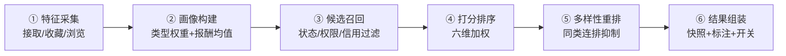
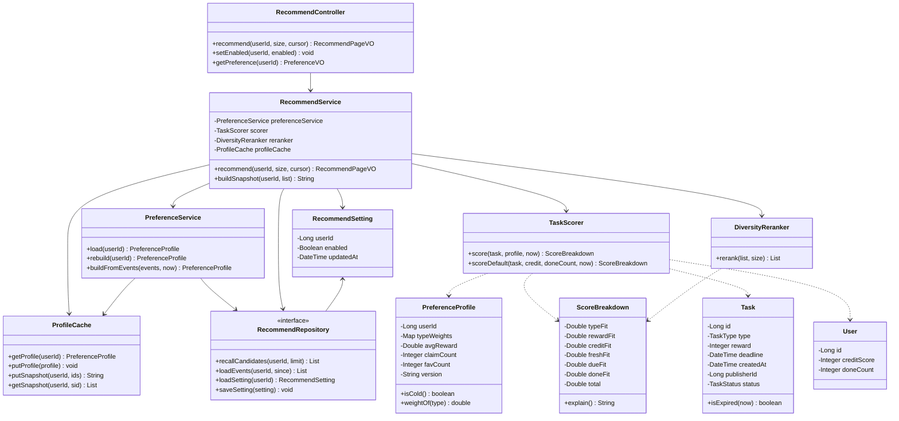
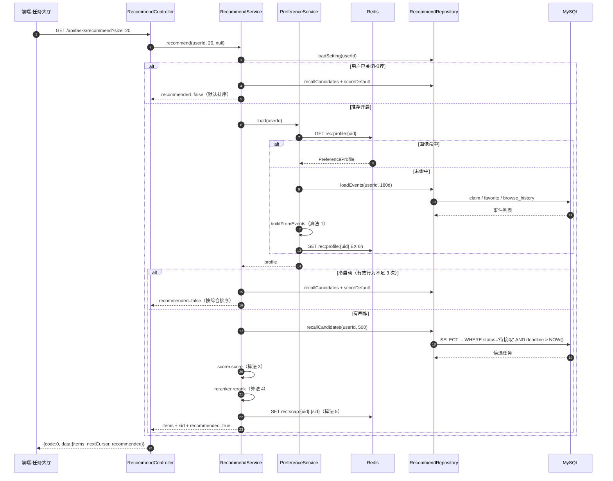
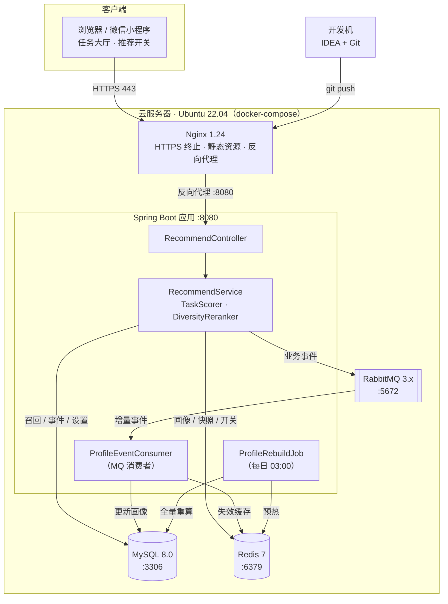

# 关键构件（模块）详细设计 · 任务偏好推荐模块（TK-06）

> 依据：《需求文档 2》TK-06 偏好推荐、TK-01 任务大厅、TK-05 筛选与排序
> 对应图片列的四个核心设计：**推荐算法** / 接收任务相关函数 / 冲突算法 / 信誉评分 —— 本文选 **① 推荐算法**
> 交付内容：类详细设计、关键算法设计、数据与接口设计、部署图、验收与测试

---

## 一页速览

| 项 | 内容 |
|---|---|
| 模块 | 任务偏好推荐（TK-06），迭代三，5 故事点 |
| 新增类 | 12 个（接口 1、应用 2、领域 5、基础设施 4），另加 3 张表 |
| 关键算法 | 画像构建（时间衰减 + 归一化）、六维打分、多样性重排、快照分页、冷启动降级 |
| 部署形态 | 应用内嵌推荐子模块 + Redis（画像/快照）+ MySQL（画像/开关/曝光）+ MQ 增量 + 每日全量任务 |
| 验收口径 | HR@10 ≥ 0.60；冷启动与默认排序逐条一致；关闭开关后重新登录仍生效；P95 < 500ms |

---

## 〇、选型：为什么从四个核心设计中选「推荐算法」

| 候选 | 对应需求 | 现有材料 | 设计增量 | 取舍 |
|---|---|---|---|---|
| **① 推荐算法** | TK-06（迭代三，5 点） | 只在包图里出现过 `MatchService` 一个类名，**无任何细化** | 大：类结构 + 6 个算法 + 指标闭环 | ✅ **选它** |
| ② 接收任务相关函数 | TK-08（迭代二，100% 完成） | 09 文档已给出「Redis 锁 + 乐观锁 + 唯一索引」三层方案与压测结论 | 小：重复劳动 | 已覆盖 |
| ③ 冲突算法 | AD-03 仲裁 / 资金拆分 | 需求给出了四种裁决的处置规则，实现未做 | 中：主要是资金拆分与状态回滚 | 与 TK-12 资金链路强耦合，拆开写会割裂 |
| ④ 信誉评分 | TK-13（迭代三，5 点） | 需求已给出完整加减分表与 60 分阈值 | 中：主要是规则落地与防刷 | 补充候选，结构可复用本文三节 |

**选它的四条理由：**

1. **只有它同时具备「可建模的类结构 + 可推导的算法 + 可量化的验收指标」**——打分函数可以手算、可以单测、可以在演示时当场验证（常做类型占比明显更高）。
2. 现有文档（03/06/08）对推荐只留了 `MatchService` 一个名字，属于**最大的设计空白**，写出来才有增量。
3. 它正好落在迭代三、由 Dybk 负责，设计可以直接转成排期任务，不与已完成的迭代二模块冲突。
4. 它的输入全部来自已建模的 `Task` / `TaskClaim` / `Favorite` / `BrowseHistory`，**不需要改动别人的领域模型**，边界干净。

> 若需要换成 ④ 信誉评分，只需替换「第四节算法」为信用分聚合与防刷，类图、部署图、验收章结构可原样复用。

---

## 一、设计目标与范围

### 1.1 需求依据（TK-06 原文）

> **用户故事**：作为接单方，我希望平台根据我以往接取的任务类型推荐相似任务，以便不用反复筛选就能看到合适的活。
>
> **功能说明**：依据 = 历史接取任务的类型分布 + 我的收藏 + 浏览历史；冷启动按大厅综合排序；推荐结果标注「为你推荐」，可关闭；推荐仅影响排序，不隐藏其他任务。
>
> **验收标准**：① 有历史接取记录的用户，推荐列表中其常做类型占比明显更高；② 无历史记录的新用户不展示推荐区或按综合排序展示；③ 用户关闭推荐后，大厅恢复默认排序并在下次访问保持。

### 1.2 设计目标

| 编号 | 目标 | 可验证方式 |
|---|---|---|
| G1 | 排序个性化：常做类型在推荐位占比显著高于默认排序 | HR@10 指标 ≥ 0.60 |
| G2 | 冷启动不劣化：无画像用户与默认排序完全一致 | 排序结果逐条比对 |
| G3 | 可关闭且持久：关闭后大厅与综合排序一致，重新登录仍关闭 | 关闭 → 登出 → 登录 → 比对 |
| G4 | 只重排不隐藏：候选集与默认排序的候选集相同 | 集合差集为空 |
| G5 | 不拖慢大厅：接口 P95 < 500ms（NFR-04） | JMeter 200 QPS 压测 |
| G6 | 可解释：每条结果能说明"为什么推荐" | 返回 `reason` 字段并可展示 |

### 1.3 边界（做什么 / 不做什么）

| 做 | 不做 |
|---|---|
| 对**任务大厅列表**做个性化重排序 | 不做独立推荐首页 / 信息流 |
| 规则 + 统计画像（可解释、可单测） | 不训练模型、不做深度召回 |
| 读接取 / 收藏 / 浏览三类事件 | 不读取会话内容、不读取手机号等隐私字段 |
| 提供开关与偏好预览接口 | 不做跨用户协同过滤（数据量与隐私都不支持） |

### 1.4 符号与术语

| 符号 | 含义 |
|---|---|
| $t$ | 任务类型（代取 / 代买 / 租赁 / 家教 / 搬运 / 其他） |
| $w_t$ | 用户对类型 $t$ 的偏好权重，归一化到 $[0,1]$ |
| $\mu$ | 用户历史任务的加权平均报酬（WB） |
| $d_e$ | 事件 $e$ 的时间衰减系数 |
| $H$ | 衰减半衰期，取 30 天 |
| fit / score | 归一化后的分项得分 / 加权总分 |

---

## 二、模块结构设计

### 2.1 在分层架构中的位置

复用 03 文档的五层架构，本模块是**应用服务层 `application.recommend` 子包 + 领域层两个纯计算类**，不新增独立服务：

```
接口层 api          RecommendController
                     ├── GET  /api/tasks/recommend
                     └── PUT  /api/users/me/recommend/enabled
应用服务层 application.recommend
                     RecommendService（用例编排 / 快照 / 开关）
                     PreferenceService（画像构建）
领域层 domain.recommend
                     TaskScorer（打分，纯函数）
                     DiversityReranker（重排，纯函数）
                     PreferenceProfile / ScoreBreakdown（值对象）
基础设施层 infrastructure.recommend
                     RecommendRepository（召回 / 设置 / 事件）
                     ProfileCache（Redis）
                     ProfileEventConsumer（MQ 增量）
                     ProfileRebuildJob（每日全量）
```

**两条设计约束：**

1. **`TaskScorer` 必须是纯函数**——入参只有 `Task`、`PreferenceProfile`、`now`，不查库、不读缓存。这样同一份输入必然得到同一分数，才能写单测、才能手算验收。
2. **个性化只发生在 `recommend` 接口内部**——大厅的默认列表接口 `/api/tasks` 不改逻辑，避免把推荐失败风险扩散到整个大厅。

### 2.2 内部流水线



每个阶段都有明确的失败降级点：②失败 → 走默认排序；③为空 → 返回空页并提示；④异常 → 记录日志并回退默认排序；⑥缓存不可用 → 跳过快照、直接分页（见 4.6）。

### 2.3 与任务类的关系（图片里的「任务类设计」如何被消费）

| Task 属性 | 在算法中的用途 | 是否新增 |
|---|---|---|
| `type` | 计算 `typeFit`，画像键 | 复用 |
| `reward` | 计算 `rewardFit`，参与 $\mu$ | 复用 |
| `deadline` / `createdAt` | 计算 `freshFit`、`dueFit` | 复用 |
| `publisherId` | 关联 `User.creditScore` / `doneCount`，供 `creditFit`、`doneFit`；用于同发布者限流 | 复用 |
| `status` | 召回过滤（仅「待接取」） | 复用 |
| `isExpired(now)` | 召回过滤 + 结果读取时二次过滤 | 复用 |

**为什么不在 `Task` 上加 `score` 字段**：分数依赖「谁在看」，同一条任务对不同用户分数不同，属于**查询期计算值**；持久化会带来一致性负担（画像一变就要重算全表）。因此分数只存在于 `ScoreBreakdown` 值对象与快照里，`Task` 保持领域纯净。

---

## 三、类详细设计

### 3.1 类图（Mermaid）



### 3.2 类职责表

| 类 | 层 | 职责 | 关键点 |
|---|---|---|---|
| `RecommendController` | 接口 | 参数校验、鉴权、组装统一响应 | **不含业务判断**（迭代二回顾的改进项） |
| `RecommendService` | 应用 | 编排「加载画像 → 召回 → 打分 → 重排 → 快照」；决定降级 | 事务边界；冷启动判断在此分流 |
| `PreferenceService` | 应用 | 画像构建与刷新，读写缓存 | 纯计算下沉到 `buildFromEvents` |
| `PreferenceProfile` | 领域 | 画像值对象：类型权重、报酬均值、样本量、版本号 | **不可变**，构建后不修改；`isCold()` 内置判定 |
| `TaskScorer` | 领域 | 打分策略：个性化 6 维 / 默认 5 维 | 纯函数，无副作用，可单测 |
| `ScoreBreakdown` | 领域 | 分项分与总分，生成可读理由 | 保留分项是为了**可解释与调参** |
| `DiversityReranker` | 领域 | 同类型/同发布者连排抑制 | 只改顺序不改候选集（G4） |
| `RecommendRepository` | 基础设施 | 召回 SQL、事件读取、开关读写 | 所有 SQL 集中在此，便于加 `EXPLAIN` |
| `ProfileCache` | 基础设施 | Redis 画像与快照 | 缓存失败一律返回 null，由上层降级 |
| `RecommendSetting` | 领域 | 用户开关持久化 | 「下次访问保持」靠它，而非前端 localStorage |
| `ProfileEventConsumer` | 基础设施 | 消费接取/收藏事件，增量刷新画像 | 幂等：按 `eventId` 去重 |
| `ProfileRebuildJob` | 基础设施 | 每日 03:00 全量重算 | 兜底增量丢失与长尾漂移 |

### 3.3 关键方法签名

```java
// 应用服务：推荐主流程
public interface RecommendService {
    RecommendPageVO recommend(Long userId, int size, String cursor);
    String buildSnapshot(Long userId, List<ScoredTask> ranked);
}

// 画像
public interface PreferenceService {
    PreferenceProfile load(Long userId);                 // 先缓存，未命中再构建
    PreferenceProfile rebuild(Long userId);              // 全量重算并回写缓存
    PreferenceProfile buildFromEvents(List<BehaviorEvent> events, Instant now);
}

// 领域：打分（纯函数，包内可见测试）
public interface TaskScorer {
    ScoreBreakdown score(Task task, PreferenceProfile profile, User publisher, Instant now);
    ScoreBreakdown scoreDefault(Task task, User publisher, Instant now);
}

// 基础设施
public interface RecommendRepository {
    List<TaskView> recallCandidates(Long userId, int limit);
    List<BehaviorEvent> loadEvents(Long userId, Instant since);
    RecommendSetting loadSetting(Long userId);
    void saveSetting(RecommendSetting setting);
}
```

### 3.4 关键不变量

| 不变量 | 含义 | 保障方式 |
|---|---|---|
| INV-1 | 候选集内不存在「自己发布」「已被接取」「已过期」的任务 | 召回 SQL 的 WHERE 条件 + 读取时二次过滤 |
| INV-2 | 同一用户同一时刻只存在一个有效画像版本 | 重建加锁 `rec:build:lock:{uid}`，TTL 60s |
| INV-3 | 分页不重复、不遗漏 | 快照不可变 + 偏移量单调递增 |
| INV-4 | 关闭开关后 `recommended=false` 且排序与默认策略逐条一致 | 开关在 Service 层最先判断，直接走 `scoreDefault` |
| INV-5 | 个性化只重排不增删候选 | 重排输入输出集合相等（单测断言） |

### 3.5 时序图：大厅首屏请求



---

## 四、关键算法设计

### 算法 1　偏好画像构建（时间衰减 + 归一化 + 冷启动判定）

```
输入：用户 u，当前时间 now，窗口 W = 180 天
输出：PreferenceProfile{typeWeights, avgReward, claimCount, favCount, version}

1. 取事件集 E（最多最近 500 条）：
     claim      ← task_claim where claimer_id = u and claimed_at > now - W
     favorite   ← favorite where user_id = u and target_type = 任务
     view       ← browse_history where user_id = u and target_type = 任务
2. 去重：同一 (事件类型, taskId) 只保留最近一次；同一发布者的反复浏览只计 3 次
3. 时间衰减：d_e = 0.5 ^ ((now - t_e) / H)，H = 30 天
4. 类型原始分：raw[t] = Σ_{e: type(e)=t} w_e · d_e
     w_claim = 3.0，w_favorite = 2.0，w_view = 1.0
5. 归一化：typeWeight[t] = raw[t] / max(raw)
     剪枝：typeWeight[t] < 0.05 的类型丢弃
6. 报酬均值（收缩估计，防止小样本失真）：
     n_eff    = Σ_{e ∈ claim ∪ favorite} d_e            // 有效单数（衰减后）
     μ_user   = Σ(w_e·d_e·reward_e) / Σ(w_e·d_e)        // 仅 claim + favorite
     μ_global = 全站近 30 天未过期任务报酬的中位数（按任务类型分组）
     μ        = (n_eff · μ_user + k · μ_global) / (n_eff + k)，k = 5
7. version = sha1(typeWeights || μ || claimCount || favCount)
8. cold = (claimCount + favCount) < 3
```

**四个设计决定的理由：**

| 决定 | 理由 |
|---|---|
| 接取权重 3 > 收藏 2 > 浏览 1 | 接取是**付出了机会成本**的强信号；浏览可能是误点，权重最低 |
| 半衰期 30 天 | 一个学期约 4 个月，30 天兼顾「学期内稳定」与「兴趣漂移」；改 `H` 只改配置，不改代码 |
| 冷启动看 claimCount + favCount，不看浏览 | 只浏览过的用户没有任何行为证据，推荐会变成猜测；浏览不足以判定偏好 |
| 归一化除以 max 而非总和 | 保留「最强偏好类型 = 1.0」的语义，避免类型多时权重被摊薄；同时 `typeFit` 的量纲稳定在 $[0,1]$ |
| 报酬用收缩估计而非直接平均 | 3 个有效样本时 μ 只有 32% 来自自己，10 个才 67%；避免「接了一单 5 元任务就认定他只接 5 元」 |
| μ 只用接取 + 收藏，不用浏览 | 浏览存在「看了贵的不买」的偏差，会把 μ 抬高；收藏是明确的意愿表达，可以进 |

**边界一：新用户没有 μ，`rewardFit` 还成立吗？**
不成立，也不需要——冷启动用户走**默认策略**，报酬项退化为绝对线性 $r/500$，与 μ 无关（见算法 3）。μ 只在非冷启动时才被用到，而那时 $n_{eff} \ge 3$，收缩估计保证它不会离谱。**"新用户没有历史"不是缺陷，而是被"换一条不依赖历史的策略"绕过去了。**

**边界二：接了 1–2 单的人算不算冷启动？**
算。`claimCount + favCount < 3` 仍判冷启动、走默认排序。代价是他暂时享受不到个性化，换来的是「一个样本不决定整个大厅的排序」；第 3 次接取或收藏后自动进入个性化，无需人工干预。

**复杂度**：事件数 $k \le 500$，时间 $O(k)$，空间 $O(|T|)$（类型至多 6 个）。单用户构建 < 1ms。

---

### 算法 2　候选召回

```sql
-- 召回：只取「可接取」的任务，上限 500 条，按默认综合分粗排后裁剪
SELECT t.id, t.title, t.type, t.reward, t.deadline, t.created_at,
       t.publisher_id, u.credit_score, u.done_count
FROM task t
JOIN `user` u ON u.id = t.publisher_id
WHERE t.status = 'OPEN'                       -- 仅待接取
  AND t.deadline > NOW()                      -- 未过期（兜底状态机延迟）
  AND t.publisher_id <> #{userId}             -- 不能推荐自己发布的任务
  AND u.status = 'NORMAL'                     -- 封禁用户的任务不推荐
ORDER BY (0.30 * t.reward / 500
        + 0.30 * LEAST(GREATEST((u.credit_score - 60) / 60, 0), 1)
        + 0.30 * EXP(-TIMESTAMPDIFF(HOUR, t.created_at, NOW()) / 72 * 0.6931)) DESC,
         t.id DESC
LIMIT 500;
```

**为什么先粗排再精确打分**：精确打分要加载任务 + 发布者，若全表加载会退化成 N+1 与内存爆炸。用 SQL 把候选压到 500 条，精确打分的复杂度就与总量无关（迭代三要修的正是「列表 N+1」问题）。

**索引要求**：`idx_task_status_deadline(status, deadline)`、`idx_task_publisher(publisher_id)`；`EXPLAIN` 必须是 `ref` 而非 `ALL`，并留存截图。

---

### 算法 3　个性化打分（六维加权）

各维度先归一化到 $[0,1]$：

$$
\begin{aligned}
\text{typeFit} &= w_t \quad(\text{画像权重；未出现过的类型给 }0.10) \\
\text{rewardFit} &= \exp\!\left(-\frac{(\ln(r+1)-\ln(\mu+1))^2}{2\sigma^2}\right),\ \sigma=0.8 \\
\text{creditFit} &= \mathrm{clamp}\!\left(\frac{credit-60}{60},\,0,\,1\right) \\
\text{freshFit} &= 0.5^{\,\text{ageHours}/72} \\
\text{dueFit} &= \mathrm{clamp}\!\left(1-\frac{\text{remainHours}}{168},\,0,\,1\right) \\
\text{doneFit} &= \min\!\left(1,\ \frac{\ln(1+doneCount)}{\ln 21}\right)
\end{aligned}
$$

$$
\text{total} = 0.40\,\text{typeFit} + 0.20\,\text{rewardFit} + 0.15\,\text{creditFit} + 0.15\,\text{freshFit} + 0.05\,\text{dueFit} + 0.05\,\text{doneFit}
$$

> 纯文本版（粘进 Word 或代码注释用）：`total = 0.40*typeFit + 0.20*rewardFit + 0.15*creditFit + 0.15*freshFit + 0.05*dueFit + 0.05*doneFit`

**默认策略（冷启动 / 关闭推荐 / 降级时使用）**，对应 TK-01 的「报酬权重 + 发布者信用 + 时间衰减」：

$$
\text{total}_{default} = 0.30\,\frac{r}{500} + 0.30\,\text{creditFit} + 0.30\,\text{freshFit} + 0.05\,\text{dueFit} + 0.05\,\text{doneFit}
$$

| 维度 | 个性化权重 | 默认权重 | 为什么是这个量级 |
|---|---:|---:|---|
| 类型匹配 | 0.40 | — | 需求的核心，必须是第一权重；给 0.40 保证「常做类型明显靠前」而不是微弱领先 |
| 报酬匹配 | 0.20 | 0.30 | 报酬是用户最关心的现实因素，但不能压过类型 |
| 发布者信用 | 0.15 | 0.30 | 合理降低弃单率，但校园场景信用分普遍偏高，权重不宜过大 |
| 新鲜度 | 0.15 | 0.30 | 半衰 72 小时：新任务有曝光机会，三天前的任务不至于霸榜 |
| 截止紧迫度 | 0.05 | 0.05 | 只用来「临期优先」，单独排序列另有「即将截止」 |
| 发布者完成率 | 0.05 | 0.05 | 辅助信号，防止刷单号靠信用分混排名 |

**未出现过的类型给 0.10 而不是 0**：给 0 会让大厅彻底固化（用户永远看不到新类型任务），0.10 保留探索空间，同时不足以挤掉强偏好类型。

**可解释性**：`ScoreBreakdown.explain()` 取贡献最大的维度生成文案——`typeFit` 最大 → 「你常接『代取』类任务」；`rewardFit` 最大 → 「报酬接近你常接的 30–40 WB」；`creditFit` 最大 → 「发布者信用良好」。

---

### 算法 4　多样性重排

```
输入：已按 total 降序的列表 L（≤500），输出条数 n
输出：重排后的列表 R

1. R = []
2. while R.length < n and L 非空:
3.     cand = L[0]
4.     if 违反约束(cand, R):
5.         cand.penalized = true
6.         L[0].score = L[0].score * 0.70        // 降权后重新插入有序池
7.         重新排序 L
8.         if 连续惩罚轮数 > 3: 直接取 L[0]      // 放弃约束，避免死循环
9.     else:
10.        R.append(cand); L.remove(0)
11. 重置 L[0].score（快照中保存原始分，不影响其他用户）

约束：
  C1 连续同类型不超过 2 条
  C2 前 20 条内同一发布者不超过 2 条
  C3 前 20 条内至少出现 2 个不同类型（n ≥ 10 时）
```

| 参数 | 取值 | 理由 |
|---|---:|---|
| 连续同类型上限 | 2 | 3 条以上会让用户感觉"刷屏"，2 条既保留偏好又保留多样性 |
| 同发布者上限 | 2 / 前 20 条 | 防止一个高频发单人吃掉整个推荐位 |
| 惩罚系数 | 0.70 | 惩罚后仍可能入选（若分数差距大），避免过度干预排序质量 |
| 最大惩罚轮数 | 3 | 明确终止条件，保证最坏情况也是有限步 |

**复杂度**：最坏 $O(N \log N)$，$N=500$ 时为常数级（实测 < 2ms）。

---

### 算法 5　快照分页（保证不重复、不遗漏）

```
首页：ranked = 打分 + 重排后的前 500 条
      sid = 随机 32 位；Redis: rec:snap:{uid}:{sid} = [ (taskId, score, reason) ... ]，TTL 600s
      返回 items[0..size)、cursor = sign(sid + ":" + offset)

翻页：cursor 验签 → 解析 (sid, offset)
      list = Redis GET rec:snap:{uid}:{sid}
      若 list 不存在（超过 10 分钟或用户重开）→ 重新生成快照，从头开始，返回 stale=true
      page = list[offset, offset+size)
      按 id 批量查任务 → 过滤 非待接取 / 已过期 → 返回
      cursor' = sign(sid + ":" + (offset+size))
```

| 设计点 | 理由 |
|---|---|
| 用快照而不是 offset 分页 | 打分依赖画像与候选集，直接 offset 会因中间插入/接取产生**重复或漏项**（TK-01 验收要求"无重复无遗漏"） |
| TTL 10 分钟 | 兼顾"一定程度的实时性"与"翻页稳定性"；下拉刷新即生成新快照 |
| cursor 签名 | 防篡改 `sid`/`offset`，避免遍历他人快照 |
| 读取时二次过滤 | 快照生成后任务可能被接取，必须过滤；代价是某页可能少于 `size` 条，前端按"本页结束"处理 |
| 快照体积 | 500 条 × (id 8B + 分数 8B + 理由 40B) ≈ 30KB/用户，10 分钟过期，千人并发约 30MB，Redis 可承受 |

**备选方案（写进取舍表）**：版本化游标 `(pver, score, id)`——省 Redis 存储，但画像一变分数就漂移，翻页一致性更难保证；本项目用户量小、快照成本低，故选快照。

---

### 算法 6　冷启动与降级

```
1. profile 为 null 或 isCold() 为 true
     → 用 scoreDefault 排序，recommended = false，不返回 reason
2. 用户关闭推荐（RecommendSetting.enabled = false）
     → 同 1，且此后每次请求都先读开关，不再构建画像（省一次计算）
3. 用户当前不可接单（creditScore < 60，或同时进行中 ≥ 3 单，见 TK-08）
     → 同 1：推荐了也接不了，反而制造挫败感；前端展示"完成进行中任务后可接单"提示
4. Redis 不可用
     → 跳过快照（改为"现场打分 + 直接截断 size"），记录 WARN；不建议返回 5xx
5. 候选集为空
     → 返回空列表 + 文案「暂时没有任务，去发布一个吧」（TK-01 验收的空状态）
6. 画像重建失败（事件表异常）
     → 用上一次成功的缓存画像；缓存也没有 → 按 1 处理
```

**降级原则**：推荐是**增强功能**，任何故障都不能让大厅不可用。因此本模块内部所有异常一律捕获后走默认策略，接口仍返回 `code = 0`，仅 `recommended = false`。

---

### 算例：一次真实打分的完整走查（对应算法 1–3）

用户 1001 的画像（近 180 天）：

| 类型 | 事件 | 原始分 | 权重 $w_t$ |
|---|---|---:|---:|
| 代取 | 接取 4 次（3 / 10 / 20 / 40 天前） | $3(0.933+0.794+0.630+0.397)=8.26$ | 1.00 |
| 租赁 | 浏览 3 次（1 / 5 / 30 天前） | $1(0.977+0.891+0.500)=2.37$ | 0.287 |
| 家教 | 收藏 1 次（15 天前） | $2 \times 0.707 = 1.41$ | 0.171 |

$\mu = 33$（4 次代取的加权均值），`claimCount + favCount = 5 ≥ 3` → 非冷启动。

| 候选任务 | 类型 | 报酬 | 发布 | 剩余 | 信用 | 完成数 | typeFit | rewardFit | creditFit | freshFit | dueFit | doneFit | **total** |
|---|---|---|---:|---:|---:|---:|---:|---:|---:|---:|---:|---:|---:|
| A | 代取 | 40 | 2h | 20h | 95 | 12 | 1.000 | 0.973 | 0.583 | 0.981 | 0.881 | 0.842 | **0.915** |
| B | 家教 | 80 | 10h | 100h | 70 | 0 | 0.171 | 0.555 | 0.167 | 0.908 | 0.405 | 0.000 | **0.361** |
| C | 代取 | 5 | 1h | 4h | 78 | 3 | 1.000 | 0.095 | 0.300 | 0.990 | 0.976 | 0.455 | **0.684** |

**个性化排序**：A (0.915) > C (0.684) > B (0.361)。

**同一批任务改用默认策略（冷启动 / 关闭推荐 / 降级时）**：

$$
\text{total}_{default} = 0.30\cdot\frac{r}{500} + 0.30\,\text{creditFit} + 0.30\,\text{freshFit} + 0.05\,\text{dueFit} + 0.05\,\text{doneFit}
$$

| 任务 | 类型 | 报酬 | 个性化分 | 默认分 | 个性化名次 | 默认名次 |
|---|---|---:|---:|---:|---:|---:|
| A | 代取 | 40 | 0.915 | 0.580 | 1 | 1 |
| C | 代取 | 5 | 0.684 | 0.462 | 2 | 3 |
| B | 家教 | 80 | 0.361 | 0.391 | 3 | 4 |
| B′ | 家教 | 300 | 0.255 | 0.523 | 4 | 2 |

**结论**：C 的报酬只有 A 的 1/8，个性化下仍稳居第二；B′ 报酬 300 元，默认策略把它推到第 2，个性化却把它压到最后——因为它的类型权重只有 0.171，且报酬严重偏离 μ=33。**同一条任务在两条策略下名次相差 2 位**，这就是"推荐 vs 综合排序"最直观的演示材料。

**敏感度**：类型权重 1.0 与 0.1 的差距 = $0.9 \times 0.40 = 0.36$，而报酬项的最大贡献只有 $0.20$——**强类型偏好不可能被报酬单独翻转**，这是 TK-06「常做类型占比明显更高」在权重层面就成立的保证。

---

## 五、数据设计

### 5.1 新增表

```sql
-- 画像表：一人一行，随事件增量更新
CREATE TABLE user_preference (
  user_id       BIGINT       PRIMARY KEY COMMENT '用户ID',
  type_weights  JSON         NOT NULL    COMMENT '{"代取":1.0,"租赁":0.29}',
  avg_reward    DECIMAL(6,2) NOT NULL DEFAULT 0,
  claim_count   INT          NOT NULL DEFAULT 0,
  fav_count     INT          NOT NULL DEFAULT 0,
  sample_count  INT          NOT NULL DEFAULT 0,
  version       CHAR(40)     NOT NULL    COMMENT '画像版本，用于快照一致性',
  updated_at    DATETIME     NOT NULL,
  KEY idx_updated (updated_at)
) COMMENT '用户偏好画像';

-- 开关表：保证「下次访问保持」
CREATE TABLE recommend_setting (
  user_id    BIGINT   PRIMARY KEY,
  enabled    TINYINT(1) NOT NULL DEFAULT 1,
  updated_at DATETIME NOT NULL
) COMMENT '推荐开关';

-- 曝光表：用于评估与线上调参，异步写入
CREATE TABLE recommend_exposure (
  id         BIGINT AUTO_INCREMENT PRIMARY KEY,
  request_id CHAR(32) NOT NULL,
  user_id    BIGINT   NOT NULL,
  task_id    BIGINT   NOT NULL,
  position   INT      NOT NULL,
  score      DECIMAL(8,6) NOT NULL,
  clicked    TINYINT(1) NOT NULL DEFAULT 0,
  created_at DATETIME NOT NULL,
  KEY idx_user_time (user_id, created_at),
  KEY idx_task (task_id)
) COMMENT '推荐曝光日志';
```

### 5.2 复用的既有表

| 表 | 用到的字段 | 说明 |
|---|---|---|
| `task` | id, type, reward, deadline, created_at, publisher_id, status | 召回与打分对象 |
| `task_claim` | task_id, claimer_id, claimed_at | 强正反馈事件 |
| `favorite` | user_id, target_type, target_id, created_at | 中正反馈事件 |
| `browse_history` | user_id, target_type, target_id, viewed_at | 弱信号事件 |
| `user` | id, credit_score, done_count, status | 发布者信用与完成数 |

### 5.3 Redis 键

| 键 | 类型 | TTL | 用途 |
|---|---|---|---|
| `rec:profile:{uid}` | string(JSON) | 6h | 画像缓存，事件驱动失效 |
| `rec:snap:{uid}:{sid}` | string(JSON) | 600s | 排序快照，分页来源 |
| `rec:build:lock:{uid}` | string | 60s | 画像重建互斥 |
| `rec:setting:{uid}` | string | 300s | 开关缓存，写后立即 DEL |

---

## 六、接口设计

统一响应体遵循 PF-05：`{code, message, data}`。

### 6.1 `GET /api/tasks/recommend`

| 参数 | 类型 | 必填 | 说明 |
|---|---|---|---|
| `size` | int | 否 | 默认 20，上限 50 |
| `cursor` | string | 否 | 首页不传；翻页带上返回的 `nextCursor` |

```json
{
  "code": 0,
  "message": "ok",
  "data": {
    "recommended": true,
    "stale": false,
    "nextCursor": "eyJzaWQiOiI3ZjNh...(签名)",
    "items": [
      {
        "taskId": 2001,
        "title": "帮忙取一下东门快递",
        "type": "代取",
        "reward": 40,
        "creditScore": 95,
        "deadline": "2026-11-03T18:00:00+08:00",
        "score": 0.915,
        "reason": "你常接『代取』类任务"
      }
    ]
  }
}
```

### 6.2 `PUT /api/users/me/recommend/enabled`

```json
// 请求
{ "enabled": false }
// 响应
{ "code": 0, "message": "ok", "data": { "enabled": false } }
```

### 6.3 `GET /api/users/me/preference`（个人中心"我的偏好"标签）

```json
{
  "code": 0,
  "message": "ok",
  "data": {
    "cold": false,
    "avgReward": 33.0,
    "topTypes": [
      { "type": "代取", "weight": 1.0 },
      { "type": "租赁", "weight": 0.29 }
    ],
    "updatedAt": "2026-11-02T19:00:00+08:00"
  }
}
```

### 6.4 错误码

| code | 含义 | 处理 |
|---:|---|---|
| 0 | 成功（含降级：`recommended=false`） | — |
| 40001 | `size` 越界或 `cursor` 格式错误 | 前端修正参数 |
| 40100 | 未登录 | 跳登录引导 |
| 40902 | 快照过期且无法重建 | 前端清空列表重拉首页 |

---

## 七、部署设计

### 7.1 部署图



### 7.2 节点说明

| 节点 | 组件 | 职责 | 容量估算 |
|---|---|---|---|
| 客户端 | 浏览器 / 小程序 | 展示推荐位、开关、理由文案 | — |
| 反向代理 | Nginx 1.24 | HTTPS、静态资源、转发 | 单机足够 |
| 应用 | Spring Boot 3.2 容器 | 推荐接口 + 消费者 + 定时任务 | 单实例 200 QPS（打分 < 5ms） |
| 缓存 | Redis 7 | 画像、快照、开关、重建锁 | 千人在线约 60MB |
| 数据库 | MySQL 8.0 | 业务表、画像表、曝光表 | 画像表 1 行/人，可忽略 |
| 消息 | RabbitMQ 3.x | 解耦接取/收藏事件 | 峰值每秒几十条 |
| 调度 | 应用内 Scheduler | 每日全量重算 + 缓存预热 | 夜间低峰执行 |

### 7.3 运行时视图：画像如何保持新鲜

| 路径 | 触发 | 延迟 | 作用 |
|---|---|---|---|
| 增量刷新 | 接取 / 收藏成功后发事件 → 消费者更新 | 秒级 | 用户刚接完一单，下一刷就能看到同类任务 |
| 缓存过期 | `rec:profile` TTL 6h | 最长 6h | 兜底增量丢失 |
| 全量重算 | 每日 03:00 | 天级 | 修正漂移、清理长期不活跃用户 |

**为什么不每次请求都实时计算**：画像构建要扫 3 张表，实时做会让大厅 P95 直接超 NFR-04 的 500ms；异步 + 缓存是这一层唯一的可行解。

### 7.4 单机部署的边界与扩容

当前单应用实例即可支撑（200 QPS × 5ms 打分开销约 1 核）。若并发上升：
- 应用无状态，直接加实例（快照在 Redis，天然共享）；
- 消费者改为多实例消费同一队列（幂等已由 `eventId` 保证）；
- 若 Redis 容量吃紧，快照 TTL 从 600s 收紧到 180s。

---

## 八、验收对照与测试

### 8.1 TK-06 验收标准 → 设计 → 测试 三列对照

| 验收标准 | 支撑设计 | 测试方法 | 通过判据 |
|---|---|---|---|
| ① 常做类型占比明显更高 | 算法 1（类型权重）+ 算法 3（0.40 权重） | 造 5 条「代取」接取记录，拉推荐 top10 | 代取 ≥ 6 条（60%），且默认排序基线 ≤ 4 条 |
| ② 新用户不展示推荐区 / 按综合排序 | 算法 1 冷启动判定 + 算法 6 | 新注册账号直接拉推荐 | `recommended=false`，且逐条等于默认排序 |
| ③ 关闭后恢复默认且下次访问保持 | 算法 6 + `recommend_setting` 表 | 关闭 → 登出 → 重新登录 → 拉推荐 | 仍为默认排序，`recommended=false` |
| ④ 只重排不隐藏（G4） | 算法 4 不改集合 + 快照只重排 | 断言候选 id 集合与默认排序集合相等 | 差集为空 |
| ⑤ 大厅性能（NFR-04） | 召回上限 500 + 内存打分 | JMeter 200 QPS × 60s | P95 < 500ms，错误率 0 |

### 8.2 测试用例

| 编号 | 前置 | 操作 | 预期 |
|---|---|---|---|
| T1 | 用户接取 5 条代取 | 拉推荐 top10 | 代取占比 ≥ 60%，理由文案为「你常接『代取』类任务」 |
| T2 | 新注册用户 | 拉推荐 | `recommended=false`，结果 = 默认排序 |
| T3 | 用户关闭推荐 | 关闭 → 登出 → 登录 → 拉推荐 | 仍 `recommended=false`；个人中心开关为关闭 |
| T4 | 用户仅有 2 次浏览 | 拉推荐 | 判为冷启动，`recommended=false`（浏览不足以判定偏好） |
| T5 | 候选含自己发布 / 已被接取 / 已过期 | 拉推荐 | 三类任务均不出现 |
| T6 | 连续翻 10 页（size=20） | 记录全部 taskId | 无重复；与首屏快照集合一致 |
| T7 | 画像与缓存被清空 | 拉推荐 | 自动重建画像，响应正常，`stale=false` |
| T8 | 关闭 Redis | 拉推荐 | 返回 `code=0`，`recommended=false`，大厅可用 |
| T9 | 同一类型连续 3 条高分任务 | 拉推荐 | 第 3 条被降权，前 20 条至少出现 2 个类型 |
| T10 | 200 QPS 压测 | 拉推荐 | P95 < 500ms，CPU < 60% |

### 8.3 线上评估指标

| 指标 | 定义 | 目标 |
|---|---|---|
| HR@10 | 推荐前 10 条中属于用户 Top2 类型的占比 | ≥ 0.60（基线约 0.35） |
| CTR | 点击 / 曝光 | 不低于默认排序 |
| 类型熵 | 前 20 条类型分布的熵 | 不低于默认排序的 80%（防同质化） |
| 关闭率 | 关闭推荐用户 / 活跃用户 | < 20%（超过说明推荐质量不达标） |
| 冷启动占比 | 走默认策略的请求占比 | 作为监控项，非质量项 |

---

## 九、风险、取舍与遗留

| 风险 / 取舍 | 影响 | 措施 |
|---|---|---|
| 数据量小，协同过滤不可用 | 召回质量上限低 | 用内容偏好 + 规则重排；等曝光日志积累到万级再评估 |
| 曝光偏差 / 马太效应 | 热门更热、新任务没机会 | 只重排不隐藏；新鲜度权重 0.15；记录曝光日志便于后续纠偏 |
| 兴趣漂移（学期切换） | 旧画像拖累新需求 | 30 天半衰期 + 每日全量重算 + 用户可关闭 |
| 刷单 / 自导自演 | 画像被污染 | 排除自己发布的任务；同发布者反复浏览只计 3 次；同一任务重复事件去重 |
| 快照 10 分钟内可能展示已被接取任务 | 点进去提示"已被接取" | 读取时二次过滤；前端对 `stale` 做提示 |
| 纯规则不如模型"高级" | 答辩时可能被问 | 用数据量与可解释性论证（见 1.3 与 9.1），并保留"可替换为模型打分"的接口 `TaskScorer` |
| 个性化无 A/B 能力 | 难以证明收益 | 用 `user_id % 10` 分桶做灰度，曝光表已带 `request_id`，可直接分析 |

### 9.1 为什么不用协同过滤 / 深度学习

| 方案 | 数据要求 | 冷启动 | 可解释 | 本项目工期 | 结论 |
|---|---|---|---|---|---|
| 规则 + 统计（本文） | 几百条行为 | 天然支持降级 | 每个分数可拆解 | 5 故事点内 | ✅ 采用 |
| 用户/物品协同过滤 | 千级用户 × 万级交互 | 极差 | 难 | 需离线训练管道 | 数据不够 |
| 双塔召回 + 精排 | 十万级样本 | 无 | 黑盒 | 高 | 校园项目不现实 |

---

## 十、落地计划（迭代三，5 故事点）

| 序号 | 任务 | 产出 | 人日 |
|---:|---|---|---:|
| 1 | 建表 + 画像构建 + 缓存 + 定时重算 | `user_preference` / `PreferenceService` / `ProfileRebuildJob` | 1.5 |
| 2 | 召回 SQL + 打分策略 + 默认策略重构 | `RecommendRepository` / `TaskScorer` | 1.5 |
| 3 | 重排 + 快照分页 + 游标签名 | `DiversityReranker` / `buildSnapshot` | 1.0 |
| 4 | 开关接口 + 前端标注与理由 + 埋点 | `recommend_setting` / `/recommend/enabled` | 0.5 |
| 5 | 单测（10 例）+ 200 QPS 压测 + 验收截图 | 测试报告 | 0.5 |

**完成定义（DoD）**：第 8.2 节 10 条用例全绿；`mvn test` 通过；`/swagger-ui` 可看到 3 个接口；压测报告留档；大厅接口 P95 未劣化。

---

## 附：渲染与交付说明

- 本文 3 张图均为 Mermaid 源码（类图、时序图、部署图），粘到 <https://mermaid.live/> 即可导出 PNG/SVG，主题选 `default` 或 `neutral`。
- 若报告要求"教科书式"类图，可用 06 文档同款思路转 PlantUML：`skinparam classAttributeIconSize 0` + `-`/`+` 可见性前缀，字段类型写成 `typeWeights : Map~TaskType,Double~`。
- 文中公式在 Word 中可用「插入 → 公式」重排；数值算例（第四节末「算例」）可原样作为验收时的演示数据。
